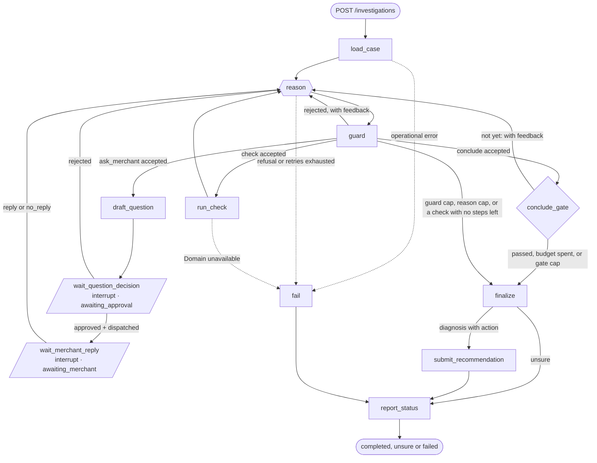

# Agent graph

v0.4 draft, Thu Nov 19, 2026. The LangGraph investigation: how the agent chooses what to check, its
state, nodes, guards, conclude gate, pause and resume, limits, and diagnostic tools. DTOs referenced here
are defined in [contracts.md](contracts.md). Facts about the data come from C-01. The code is in `agent/`,
and [agent-implementation-plan.md](agent-implementation-plan.md) covers how it is built.

The agent decides what to investigate next from the evidence. Code bounds that choice with guards and a
conclude gate, but it doesn't script a path.

## What the data can and can't show

The C-01 data sets hard limits on what any check can prove. The prompt states them, and the guards
enforce the ones that matter.

| Fact about the data                                                                                      | Consequence for the agent                                                                                                                                                      |
| -------------------------------------------------------------------------------------------------------- | ------------------------------------------------------------------------------------------------------------------------------------------------------------------------------ |
| Time slices are `daypart` values, meal periods from order time. There are no crew schedules.             | The agent can show that a problem sits in `dinner`. Linking it to a crew or shift needs a merchant answer.                                                                     |
| There is no bag data. `item_count` is the proxy for multi-bag orders.                                    | Hypotheses say "large orders, 5+ items", not "multi-bag orders". The bag mechanism can only come from `customer_comments` or the merchant.                                     |
| There is no Dasher data.                                                                                 | `dasher_handoff` can't be tested from platform data, so it is never `supported` or `ruled_out` (G5). It ends `inconclusive` with a stated gap, even after a merchant reply.    |
| `menu_change` and `pos_change` events link to items only through their free-text `description`.          | The agent reads `event_log` descriptions to connect an event to an item or modifier, then tests that link with `compare_periods`.                                              |
| Modifiers have no IDs.                                                                                   | Filters and targets use modifier names, such as `Extra sauce`, matching `order_items.modifiers` and `mi_claims.modifier_detail`.                                               |
| A claim names at most one `item_id` and one `modifier_detail`.                                          | An `item_id` or modifier group, filter or target counts the orders that contain the value but only the claims that name it, never every claim on those orders. An effect on whole orders, such as a promotion's, is tested by its dates or by order size. |
| Pending claims count toward rates, and claims with `review_label` of `fraud` or `not_store_fault` don't. | Every result reports `pending_claims`. A finding that rests mostly on `pending` claims is weaker evidence.                                                                     |
| Rates on a few hundred orders or fewer swing by several points by chance.                                | A trend counts when it moves back toward baseline, not when it dips between two elevated periods. |
| `customer_comments` are free text written by customers.                                                  | Comments, read through `sample_evidence`, can suggest a hypothesis but can't measure how often something happens. They are passed to the model as data, never as instructions. |
| History covers Oct 5 to Nov 15, 2026.                                                                    | The window is the 42 days ending on the store-local date of the case's `window_end`, which leaves room before every seeded cause.                                              |
| The Golden Dataset answer key sits in the `eval` schema.                                                 | No tool reads it.                                                                                                                                                              |

## Cause patterns

The prompt tells the model what each `error_category` means and what pattern each `cause_category` tends to
leave in the data, so it writes expectations from the data model. An item that arrives without its chosen
modifier is an `ingredient_error` or `incorrect_item`. A `missing_item` means the whole item wasn't in the bag.
Patterns marked "usually", "often" or "tend" are tendencies, and a missing tendency alone doesn't rule a cause
out. The patterns name no store, item, modifier or date, and the tool examples use placeholders.

| Cause | Pattern in the data | Separated from its nearest rival by |
|---|---|---|
| `pos_modifier_mapping` | Claims on orders with one modifier, named in `modifier_detail`, mostly `incorrect_item` and `ingredient_error`; the same items ordered without it stay near baseline. Starts when the modifier is added or the POS changes, and stays well above baseline across days and dayparts until fixed | Claims that stay well above baseline (`menu_change`, `inventory`). Only the merchant can confirm that the modifier doesn't print on the ticket |
| `menu_change` | Claims on what changed, such as a recipe, an item, or a new modifier that staff mishandle, from the day of the change. They tend to fall back toward baseline as staff learn, or sit in some dayparts. `menu_data_mismatch` cancellations can rise | Claims that fall back toward baseline or sit in some dayparts (`pos_modifier_mapping`) |
| `packing` | Mostly `missing_item`, usually spread over many items, often add-ons. Often peaks in the busiest dayparts and in large orders (5+ items), where the same item is missed more than in small ones | The same item missed more often as order size grows, with no matching `item_out_of_stock` cancellations (`inventory`) |
| `inventory` | Claims on one or a few items, or on a modifier whose ingredient ran out, on the days or dayparts supply ran short. They often come and go with supply | An item's rate about the same in small and large orders that contain it. `item_out_of_stock` cancellations support it but can be absent (`packing`) |
| `dasher_handoff` | `wrong_order` claims, or missing bags that look like packing | Platform data can't separate it from `packing` |
| `fraud_cluster` | A few `customer_ref` values with repeated pending claims, often for a whole order | A store-wide rise that holds with `review_label` `store_fault` alone, tested with no `item_id` or `modifiers` filter because whole-order claims name neither |
| `other` | A specific store-side cause outside the six, such as a promotion or staffing gap that overloads the kitchen in one daypart | Its statement names the cause. Items left out of bags in one daypart are still `packing`. It ends in the analyst handoff (K5) |

Large orders hold more items, so any item-level fault has a higher rate on them. The model compares the same
item across order sizes instead. An event's type records what changed, not which cause followed. A
`menu_change` event that adds a modifier can start a `pos_modifier_mapping` fault or a `menu_change` cause,
and K4 lets either leader cite it.

## Graph



The graph has one loop and no per-cause branch. Every path back into `reason` carries the new finding,
reply or rejection reason, and `reason` decides again from the full state. The question nodes run from M3;
until then, `guard` rejects every question.

## Nodes

| Node                     | Model call | Does                                                                                                                                                                                                                                                                                                                    | Next                                                 |
| ------------------------ | ---------- | ----------------------------------------------------------------------------------------------------------------------------------------------------------------------------------------------------------------------------------------------------------------------------------------------------------------------- | ---------------------------------------------------- |
| `load_case`              | No         | Reads the case, the store, and the store overview for the window. Reads the store's menu from `GET /stores/{store_id}/menu` and fills `known_items` and `known_modifiers`. Adds the overview's evidence IDs to `retrieved_evidence_ids` and passes the overview to `reason` as the first finding. Records claims excluded with `review_label` of `fraud` or `not_store_fault`. Also calls `fraud_signals` for the window, sets `suspect_cluster` when it flags any `customer_ref`, and adds its evidence IDs. Reads the action catalog, or uses the bundled copy when Domain has no catalog route (see [Routes Domain doesn't have](#routes-domain-doesnt-have)). The window is the 42 days ending on the case's `window_end`, kept inside the first and last of the case's `daily_rates`. None of these calls counts toward the step limit. For a reopened case, loads the prior run's hypotheses and rulings, and adds the failed recheck as evidence against the cause that was acted on. | `reason`                                             |
| `reason`                 | Yes        | Assesses the latest finding, updates every hypothesis it bears on, and picks one next action with a full plan. Returns a `ReasonOutput`.                                                                                                                                                                                | `guard`                                              |
| `guard`                  | No         | Applies the rules in [Guards](#guards) to every output: check, question and conclusion. A rejected output goes back to `reason` with the rule IDs attached, at most twice in a row. An accepted check with no steps left ends the run.                                                                                    | `run_check`, `conclude_gate`, `reason` or `finalize` |
| `run_check`              | No         | Calls one allowlisted read-only tool with validated arguments. Stores the plan, the result, and the evidence IDs in `retrieved_evidence_ids`.                                                                                                                                                                           | `reason`                                             |
| `draft_question`         | No         | Creates a `merchant_question` proposal through Domain's internal route. Sets status `awaiting_approval`.                                                                                                                                                                                                                | `wait_question_decision`                             |
| `wait_question_decision` | No         | Pauses with `interrupt()`. On resume, reads the decision from Domain.                                                                                                                                                                                                                                                   | approved: `wait_merchant_reply`. rejected: `reason`. |
| `wait_merchant_reply`    | No         | Sets status `awaiting_merchant` and pauses. On resume, reads the reply from Domain. The reply becomes evidence with an `EV-RPL` ID.                                                                                                                                                                                     | `reason`                                             |
| `conclude_gate`          | No         | Checks the conclusion against the [conclude rules](#conclude-gate).                                                                                                                                                                                                                                                     | `finalize` or `reason`                               |
| `finalize`               | No         | Writes the `InvestigationResult` from state and the conclusion, using the [truth table](#how-finalize-decides). Cited IDs must be in `retrieved_evidence_ids` and pass Domain's resolve check, and the action, owner and recheck days come from the catalog.                                                          | `submit_recommendation` or `report_status`           |
| `submit_recommendation`  | No         | Creates the `intervention` or `handoff` proposal through Domain's internal route. On 409 `PROPOSAL_PENDING` it recovers the proposal this investigation created. Approval is then tracked on the proposal, not the graph.                                                                                              | `report_status`                                      |
| `fail`                   | No         | Records an operational error as status `failed` with `error.code`, and writes a structured log line.                                                                                                                                                                                                                    | `report_status`                                      |
| `report_status`          | No         | Reports `completed`, `unsure` or `failed` to Domain with `PUT /internal/cases/{case_id}/investigation`. The call is idempotent. If it fails, an analyst's next read of the investigation retries it in the background: one attempt at most every 30 seconds, with that analyst's JWT. A viewer's read never retries it. | end                                                  |

The model never calls write endpoints. Proposals are created only by the deterministic `draft_question`
and `submit_recommendation` nodes, after validation. Every terminal path passes through `report_status`,
so a case never stays `investigating`.

### Routes Domain doesn't have

The catalog route, the proposals route and the status route can be missing from a Domain build. Domain's access
policy already allows them, so once a call passes authorization and finds no handler, Domain answers with its
generic 404: code `NOT_FOUND`, the message exactly "Not Found" and empty or null `details`. The agent treats only
that answer as a missing route. A 404 for a missing resource, such as `CASE_NOT_FOUND`, never matches, and a
route outside Domain's policy gets 403.

| Call | When the route is missing |
|---|---|
| `GET /catalog/actions` | `load_case` uses the bundled catalog (`app/data/catalog.json`) and sets `run_config.catalog_source` to `bundled`. |
| `POST /internal/cases/{case_id}/proposals` | The diagnosis still completes. `proposal_id` stays null and `evidence_gaps` says the recommendation wasn't saved as a proposal. |
| `PUT /internal/cases/{case_id}/investigation` | The status isn't reported and isn't retried. |

Any other error on these calls is handled as usual. When the routes exist, the agent uses them with no
configuration change, as long as Domain and the agent share `INTERNAL_SERVICE_TOKEN`.

## How `reason` works

Each turn, the model receives:

- **The case and store.** The trigger, window, timezone, and exclusions. Also the store's menu: item IDs, item names and modifier names, so filters use values that exist.
- **The data limits.** The table above, so the model knows what no check can prove.
- **The hypotheses.** Every hypothesis with its status, evidence and rationale, plus causes ruled out in a prior run. On a new case the list starts empty, and the first turn opens at least two.
- **The latest result.** Its headline, metrics and notes in full, plus at most 20 of its evidence IDs and the total count. These are the first 20 in the order the Domain Service returns them, which puts the most concentrated group's newest records first. See "Evidence ID ordering" in [contracts.md](contracts.md#evidence-id-ordering). Every returned ID still goes into `retrieved_evidence_ids`. To cite records from another group, the agent runs `sample_evidence` filtered to that group. On the first turn, this is the store overview from `load_case`. Earlier checks appear as their plan and headline only.
- **Pending feedback.** Any rejection from `guard` or `conclude_gate`.
- **Budget.** Steps left, questions left, and whether a question is open.
- **Untrusted text.** `customer_comments` and merchant reply `text` are quoted and marked as data.

The prompt is rebuilt from state on every turn, with no transcript. It has four parts:

| Part | Role | Holds | Changes |
|---|---|---|---|
| S1 | system, cached | Role, the discipline below, the data limits, the cause patterns, the tool catalog rendered from the tool registry, and the rules in plain words | Never within a run |
| U1 | user, cached | Case and trigger facts, window, timezone, exclusions, the suspect flag, the menu, the action catalog, prior-run rulings | Never within a run |
| U2 | user | Hypotheses, the check history one line each, the event ledger, the latest result in full, and any rejection feedback. Counts narrowed to an item or modifier are labeled as claims that name the value over orders that contain it | Every turn |
| C | system, last | Turn and budget counters, whether `matched` is due, the failed rule IDs, and the K1-K5 checklist | Every turn |

Domain text in U1 and U2 is escaped, capped at 300 characters and placed inside `<data>` blocks. C holds no
quoted values.

The system prompt asks for a fixed discipline, not a fixed path:

1. **Keep competing hypotheses open.** Start from the overview with at least two plausible causes. Never investigate only one.
2. **Assess the finding.** State in one to three sentences what the latest result shows and how reliable it is. Note the pending share and any insufficient groups.
3. **Update every hypothesis it bears on.** Mark each one supported, contradicted, unchanged or newly added, with a one-sentence rationale.
4. **Choose the most informative next step.** Pick the check whose possible results would best separate the leading hypotheses. Before the call, state what each result would mean.
5. **Explain every event near the rise.** Any `menu_change`, `pos_change`, `store_downtime` or `promotion` event close to the start of the rise is a candidate until a check rules it out.
6. **Try to disprove the leader.** Before concluding, run at least one check that would expose the leading cause if it were wrong.
7. **Ask the merchant only when it pays off.** That means an answer could separate hypotheses that platform data can't, such as how large orders are bagged, how bags reach the Dasher, or whether a crew changed.

### `ReasonOutput`

`reason` returns one JSON object through structured output. Every field is required and none is
nullable, so "nothing" is `""`, `[]` or `0`. The schema has one union, `next_action`. Single-value tags
such as `type` are one-value enums.

A check's `request` is a JSON object written as a string. The API compiles the schema into a grammar, and
the eight per-tool request shapes make that grammar too large to compile, so the request is validated in
code: the agent decodes the string and checks it against the request model for its `tool` (and, for
`sample_evidence`, its `evidence_type`). Inside a filter or scope, a field the model leaves out means no
constraint. A malformed request is a `SCHEMA` rejection that names the bad field.

```python
class ReasonOutput(BaseModel):
    assessment: str                          # one to three sentences on the latest result
    matched: list[Matched]                   # {hypothesis_id, outcome: if_true | if_false | neither}
    hypothesis_updates: list[HypothesisUpdate]
    new_hypotheses: list[NewHypothesis]
    next_action: CheckAction | AskMerchantAction | ConcludeAction

class HypothesisUpdate(BaseModel):           # changes an existing hypothesis
    hypothesis_id: str                       # an existing HYP- id
    status: hypothesis_status
    statement: str                           # a narrower statement, or "" to keep it
    add_supporting: list[str]                # evidence IDs from retrieved_evidence_ids
    add_contradicting: list[str]
    rationale: str                           # one sentence

class NewHypothesis(BaseModel):              # opens a hypothesis with status open
    ref: str                                 # e.g. "N1"; usable as a hypothesis ID elsewhere in the same output
    cause_category: cause_category           # "other" needs a specific statement
    statement: str
    rationale: str
    evidence: list[str]

class CheckAction(BaseModel):
    type: Literal["check"]
    plan: CheckPlan

class CheckPlan(BaseModel):
    kind: Literal["explore", "test", "challenge"]
    purpose: str                             # one sentence, shown in the UI
    discriminates: list[str]                 # hypotheses this check separates
    expectations: list[Expectation]          # {hypothesis_id, if_true, if_false}, one per discriminated hypothesis
    challenges: str                          # the targeted hypothesis for a challenge, else ""
    request: str                             # JSON for one of 8 request shapes, tagged with its tool; validated in code

class AskMerchantAction(BaseModel):
    type: Literal["ask_merchant"]
    question_text: str
    why_asked: str                           # which hypotheses the answer separates

class ConcludeAction(BaseModel):
    type: Literal["conclude"]
    leading_hypothesis_id: str
    rise_started_at: str                     # store-local date the rise began
    confidence: confidence
    summary: str                             # at most four sentences, citing numbers from the results
    recommendation: Recommendation           # {action_id, rationale, target}
```

The request variants are `store_overview`, `event_log`, `claim_breakdown`, `compare_periods`, two
`sample_evidence` variants (claims or cancellations), `cancellation_breakdown` and `fraud_signals`.
Filters use `[]` and `0` for "no constraint". Code converts a request to the contract shape in
[contracts.md](contracts.md#diagnostics-agent-to-domain-reads), dropping empty values; `compare_periods`
with `control_mode: "rest_of_store"` sends `control: null`. The tool and its normalized arguments form the
check's canonical key, which the duplicate rule uses.

Enum values are lowercased before validation. Merchant reply claims (`reply_claims`) join the schema with
merchant questions.

Check kinds:

- **`explore`** looks broadly, such as a first breakdown of claims by item or a read of the event log. It needs no hypotheses. At most three per run.
- **`test`** separates named hypotheses and states what each would predict.
- **`challenge`** targets the leading hypothesis with a result that would expose it if it were wrong. Examples: did orders without the suspect modifier rise too, did the rise start before the suspected event, or does the pattern outlast a promotion?

## Guards

`guard` checks every `ReasonOutput` before anything runs or is saved: the hypothesis changes, `matched`,
and the next action, whether it is a check, a question or a conclusion. It reports every violation, each
under its rule ID.

| #   | Rule | Why |
| --- | ---- | --- |
| G1  | Cited evidence IDs are in `retrieved_evidence_ids` | No invented evidence |
| G2  | Updates name existing hypotheses. New ones come only from `new_hypotheses`, each with a unique `ref`. `other` needs a specific statement. A cause that is already open or supported isn't opened twice; its statement is narrowed instead. | Hypotheses stay distinct and traceable |
| G3  | `supported` needs a sufficient `test` or `challenge` check from a tool that returns rates, whose result matched the hypothesis's `if_true`. `event_log` and `sample_evidence` never count. | No support from thin data or from exploration alone |
| G4  | `ruled_out` needs a sufficient check from a tool that returns rates that listed the hypothesis in `discriminates` and matched its `if_false`, plus a rationale | No silent drops. A flat result cites the check, since no rows sit behind it. |
| G4b | `inconclusive` needs a discriminating check that was insufficient or matched `neither`, or a data-limit cause such as `dasher_handoff`, plus a rationale stating the gap | An open question is written down, not dropped |
| G5  | `dasher_handoff` is never `supported` or `ruled_out` | There is no Dasher data. A merchant reply plus consistent platform data can only move it to `inconclusive` or into the result's gaps. |
| G6  | A cause ruled out in a prior run stays ruled out unless new contradicting evidence is cited | Reopening doesn't erase earlier findings |
| G7  | A merchant reply alone can't make a hypothesis `supported` | Replies are weighed against platform evidence, as the sprint plan requires |
| G8  | At least two hypotheses exist after every turn | Competing explanations stay open |
| G9  | `matched` covers exactly the latest check's expectations while that check is unmatched, and is empty otherwise | Every result is assessed against what was predicted |
| G10 | Arguments are valid: `days_before` and `days_after` 1 to 28, `limit` 1 to 10, start on or before end, weekday 0 to 6, item count minimum at most the maximum | Domain would reject them, wasting a step |
| G11 | Values exist: item IDs and modifier names from the menu, matched case-insensitively and rewritten to the menu's spelling, and dates inside the window, including both `compare_periods` spans | Same |
| G12 | A `test` or `challenge` names the hypotheses it separates with one expectation each. A challenge names its target in `challenges`, and the target is open or supported. | Every focused check has a stated reason |
| G13 | At most three `explore` checks per run | Exploration must turn into testing |
| G14 | The same tool with the same arguments never runs twice, including the `store_overview` and `fraud_signals` calls made by `load_case` | No loops on repeated checks |
| G15 | A check needs a step left. Otherwise the run goes to `finalize` with the budget spent. | The step limit holds |
| G16 | A question needs a question left and none open | At most two per run, one at a time |
| G17 | A question's content passes the output policy and names what it separates | The analyst approves a clear question |
| G18 | A conclusion names an existing leader, a rise date inside the window, a catalog action that applies to the leader's cause, and a target whose values exist on the menu and were tested by a check that supported the leader | The recommendation matches the evidence |
| P1  | Free text (summary, rationales, statements, questions, purposes) requests no refunds, credits, store charges, deactivation, menu edits or customer contact, and contains no URLs, emails, phone numbers or `customer_ref` values. A hit is logged as `blocked_action`. | The agent recommends catalog actions only and never exposes personal data |

G6, G7 and G17 arrive with reopening and merchant questions. Until merchant questions are on, G16 rejects
every question.

A rejected output returns to `reason` with the failed rules and their details. After two rejections in a
row, the graph goes to `finalize`, which returns `unsure` and lists the failed rules as evidence gaps.

## Conclude gate

A `diagnosis` passes when all of these hold:

1. **K1. The leader is supported.** The leading hypothesis is `supported` under the guard rules.
2. **K2. It survived a challenge.** A `challenge` check targeted it, had sufficient data, came from a tool that returns rates, and matched its `if_true`. Its signature (tool, `group_by` and filter fields) differs from every `test` that supported the leader.
3. **K3. Every rival is accounted for.** Each other hypothesis is `ruled_out`, or `inconclusive` with its gap written down.
4. **K4. Every event near the rise is explained.** An all-types `event_log` covered the rise date plus or minus 7 days. Each event overlapping that span is cited by a rival that has a status, or by the leader when the event's type fits its cause (`menu_change` or `pos_change` for `pos_modifier_mapping` and `menu_change`) and it starts within one day of the rise.
5. **K5. No `other` cause has an automatic action.** A cause outside the list can only end in the analyst handoff.

If the gate fails and budget remains, `reason` gets the unmet conditions as feedback. A second failed
conclusion ends the run as `unsure`. The control message shows the K1-K5 checklist on every turn.

### How finalize decides

`finalize` makes no model call. The conclusion supplies the narrative and the chosen catalog action, and
code applies this table:

| How the loop ended | Outcome |
|---|---|
| The gate passed | `diagnosis`, at the conclusion's confidence after the caps |
| The budget ran out, the last action was a conclusion, and K1, K2 and K5 hold | `diagnosis` at most `medium`. Unmet K3 or K4 conditions become `evidence_gaps`. |
| The budget ran out otherwise, two guard rejections in a row, two failed conclusions, or the reasoning-turn cap | `unsure`. The leading candidate and the failed rules go in `evidence_gaps`. |

Confidence is capped at `medium` when any rival is `inconclusive`, when the budget ran out, or when the
checks supporting the leader rest mostly on `pending` claims. Citations that fail Domain's resolve check
are dropped and listed as a gap. The result's contradicting evidence is what contradicted the leader, plus the
records that pointed to any other cause; a ruled-out cause's are explained by its `ruled_out` entry. Records the
leader cites, or that a check confirming it returned, are left out. In the summary, the recommendation's
rationale, the ruled-out reasons and the gaps, a percentage, an n/d fraction or a count of claims, orders or
cancellations that no check result, record, case fact or catalog threshold shows is replaced with `[withheld]`
and listed as a gap.

The agent proposes the most likely cause. The analyst's approval and, where asked, the merchant's reply
confirm it.

## Merchant questions and replies

- **When to ask.** An answer must be able to separate named hypotheses, or confirm one that platform data can't test. `why_asked` names them, and the analyst sees that reason when approving.
- **What only the merchant knows.** In this data, that means bagging practice for large orders, how bags reach the Dasher, crew or staffing changes by daypart, and whether a menu or POS change reached the kitchen tickets.
- **How many.** At most two per run, and one open at a time. Every question still needs analyst approval before it is sent.
- **What a reply does.** It becomes evidence, and `reason` extracts its factual statements into `reply_claims`. Statements that platform data can check are tested next. For example, if a merchant says "we fixed the mapping on Nov 10", the agent compares the periods before and after Nov 10.
- **Conflicts.** A reply that conflicts with platform data is recorded as contradicting evidence. The platform data wins, and confidence drops.
- **No reply or rejection.** `no_reply` lowers confidence on any hypothesis that depended on an answer. A rejected question is recorded, and `reason` continues without asking it again.

## Pause and resume

`thread_id` is the `investigation_id`. Checkpoints live in the `agent` schema through LangGraph's Postgres
checkpointer.

- **Pausing.** `wait_question_decision` and `wait_merchant_reply` call `interrupt()`, and the checkpoint is saved. The API returns the current status.
- **Resuming.** The frontend calls `POST /investigations/{id}/resume` after the analyst decides the question or records a reply. The request carries a fresh JWT. The node re-reads the proposal or replies from Domain and never trusts the resume body.
- **No duplicate effects.** If nothing has changed in Domain, resume returns the current view and does nothing else. A resume on a finished investigation returns 409 `INVESTIGATION_FINISHED`.
- **Restarts.** A paused investigation survives a container restart because its checkpoint is in Postgres.
- **Reopening.** After a failed recheck, Domain marks the case `reopened`. The analyst starts a new investigation with `reopen_of` set. A second failed recheck sends the case to `analyst_review`, and no third run is allowed.

## Diagnostic tools

All tools are read-only and scoped to the case's store. The Domain Service computes every number using
the rate rules in [contracts.md](contracts.md). Each description says what the tool measures and what it
can't show, because that is what the model chooses from.

| Tool                     | Measures                                                                                                                                                                                         | Can't show                                             | Domain endpoint                                        | Source tables                  |
| ------------------------ | ------------------------------------------------------------------------------------------------------------------------------------------------------------------------------------------------ | ------------------------------------------------------ | ------------------------------------------------------ | ------------------------------ |
| `store_overview`         | Overall rate, eligible orders, claims by `review_label` and `error_category`, daily trend                                                                                                        | Why the rate moved                                     | `GET /stores/{id}/overview`                            | orders, mi_claims              |
| `event_log`              | Events of every `event_type`: `menu_change`, `pos_change`, `store_downtime` and `promotion`, with `started_at`, `ended_at` and `description`                                                     | Their effect. Pair with `compare_periods`.             | `GET /stores/{id}/diagnostics/events`                  | operational_events             |
| `claim_breakdown`        | Claim share against order share, plus rate, for any grouping within any filter                                                                                                                   | Cause. Concentration is a lead, not proof.             | `POST /stores/{id}/diagnostics/claim-breakdown`        | orders, order_items, mi_claims |
| `compare_periods`        | Rate before and after a date, for a target and a control                                                                                                                                         | Whether the event caused the change, without a control | `POST /stores/{id}/diagnostics/compare-periods`        | orders, order_items, mi_claims |
| `sample_evidence`        | Up to 10 claim or cancellation records for a filter, with `customer_comments`                                                                                                                    | Frequency. Samples illustrate and don't measure.       | `POST /stores/{id}/diagnostics/evidence-sample`        | mi_claims, cancellations       |
| `cancellation_breakdown` | Cancellations grouped by `cancellation_category`, `item_id`, `daypart`, weekday or day. Categories are `item_out_of_stock`, `too_busy`, `menu_data_mismatch`, `pos_technical_error` and `other`. | M&I claims. Canceled orders never have claims.         | `POST /stores/{id}/diagnostics/cancellation-breakdown` | cancellations, orders          |
| `fraud_signals`          | `customer_ref` values with at least `FRAUD_MIN_PENDING_CLAIMS` (default 4) pending claims in the window                                                                                          | Whether a claim is fraudulent. It flags, never judges. | `GET /stores/{id}/diagnostics/fraud-signals`           | mi_claims, orders              |
| `merchant_replies`       | Replies to this case's approved questions                                                                                                                                                        | Whether a reply is true                                | `GET /cases/{case_id}/merchant-replies`                | C-04                           |
| `action_catalog`         | Allowed interventions and handoffs                                                                                                                                                               | —                                                      | `GET /catalog/actions`                                 | C-03                           |

`claim_breakdown` groups by `item_id`, `modifier`, `daypart`, `weekday`, `item_count`, `error_category`,
`review_label` or `day`. Its `ClaimFilter` accepts `item_id`, `modifiers`, `daypart`, `weekday`, an
`item_count` range, `error_category` and `review_label`. Request shapes are `ClaimBreakdownRequest`,
`ComparePeriodsRequest`, `EvidenceSampleRequest` and `CancellationBreakdownRequest` in the contracts.
Grouped by `modifier`, claims with no `modifier_detail` form no group but still count in the totals. `day` and
`weekday` use the store-local date of the order. See [Rate rules](contracts.md#rate-rules) and
[Conventions](contracts.md#conventions).

### Metric names

Every `Metric` in a `ToolResult` uses one of these names, so the prompt can rely on them. A rate is
`null` when its group has fewer than `MIN_GROUP_ORDERS` eligible orders.

| Tool | Metric `name` | `group` | `unit` | Meaning |
|---|---|---|---|---|
| `store_overview` | `claim_rate` | none | rate | Attributable claims divided by eligible orders in the window |
| `store_overview` | `claim_count` | `review_label=<value>`, all four labels | count | Claims per label, including the excluded `fraud` and `not_store_fault` claims |
| `store_overview` | `claim_count` | `error_category=<value>` | count | Attributable claims per error category |
| `store_overview` | `daily_claim_rate` | `day=<YYYY-MM-DD>` | rate | The rate for each day in the window |
| `claim_breakdown` | `claim_rate` | `<group_by>=<value>`, such as `modifier=Extra sauce` | rate | The group's attributable claims divided by its eligible orders |
| `claim_breakdown` | `claim_share` | same | share | The group's share of all attributable claims in the filter |
| `claim_breakdown` | `order_share` | same | share | The group's share of all eligible orders in the filter |
| `compare_periods` | `rate_before`, `rate_after` | `target` or `control` | rate | The rate in the period before and after `split_date` |
| `cancellation_breakdown` | `cancellation_rate` | `<group_by>=<value>` | rate | The group's cancellations divided by its placed orders |
| `cancellation_breakdown` | `cancellation_count` | same | count | The group's cancellations |
| `fraud_signals` | `claim_count` | `customer_ref=<ref>`, flagged refs only | count | Pending claims from one `customer_ref`. A ref is flagged only when it has at least `FRAUD_MIN_PENDING_CLAIMS` (default 4) pending claims in the window |

`event_log` and `sample_evidence` return no metrics. Their records come in `ToolResult.evidence`.

`evidence_ids` in every result arrive in the fixed order defined under "Evidence ID ordering" in [contracts.md](contracts.md#evidence-id-ordering). The `reason` prompt shows the first 20.

`POST /evidence/resolve` validates citations in `finalize`. It is not offered to the model as a tool.

`GET /stores/{store_id}/menu` is read once by `load_case`. It is not offered to the model as a tool, because the menu is already in every `reason` prompt.

A `handoff_signals` tool for Dasher events is reserved. It will be added only if a Dasher table exists.

## Example: STORE-B, dinner packing with distractors

From Nov 3, `missing_item` claims rise on `dinner` orders with 5 or more items. The seeded distractors
are a Nov 1 `menu_change` to a dessert price, a `promotion` event from Nov 3 to Nov 9 that raises order
volume, `too_busy` cancellations on Friday dinners across all six weeks, and four claims with
`review_label` `fraud`. Outcomes below follow the C-01 seed description. Exact numbers will come from
the real data.

| Turn | Check, with kind                                                                                                    | Result                                                                                                                              | Hypothesis updates                                                                                                                                                |
| ---- | ------------------------------------------------------------------------------------------------------------------- | ----------------------------------------------------------------------------------------------------------------------------------- | ----------------------------------------------------------------------------------------------------------------------------------------------------------------- |
| 1    | No check. `reason` reads the overview that `load_case` fetched.                                                     | Rate rises in early November, mostly `missing_item`. Four `fraud` claims already excluded.                                          | Opens `packing`, `menu_change`, and promotion overload as `other`. Adds `dasher_handoff`, since whole bags might be missing.                                      |
| 2    | `event_log`, explore                                                                                                | Nov 1 `menu_change` to a dessert price. `promotion` Nov 3–9.                                                                        | Both events start near the rise, so both stay candidates.                                                                                                         |
| 3    | `claim_breakdown` grouped by `item_count`, filtered to Nov 3 onward, test                                           | The `5+` bucket holds a far larger share of claims than of orders                                                                   | `packing` supported. A price change can't explain missing items on large orders, so `menu_change` is contradicted.                                                |
| 4    | `claim_breakdown` grouped by `daypart`, filtered to `item_count_min` 5 from Nov 3, test                             | Concentrated in `dinner`. `lunch` stays normal.                                                                                     | `packing` narrows to `dinner` on large orders                                                                                                                     |
| 5    | `compare_periods` for `dinner` orders with `item_count_min` 5, split Nov 10, 7 days before, 6 days after, challenge | The rate stays high after the promotion ends                                                                                        | `packing` survives. Promotion overload ruled out as the explanation.                                                                                              |
| 6    | `cancellation_breakdown` grouped by weekday, filtered to `dinner`, test                                             | `too_busy` cancellations on Friday dinners, at the same level before and after Nov 3                                                | A long-standing pattern unrelated to the rise. Recorded as contradicting overload.                                                                                |
| 7    | `sample_evidence`, claims on `dinner` orders with 5+ items, explore                                                 | `customer_comments` such as "whole second bag never arrived"                                                                        | Store-side `packing` and `dasher_handoff` both fit. Platform data can't separate them.                                                                            |
| 8    | Ask the merchant, analyst approves                                                                                  | Asks how large dinner orders are bagged and whether all bags are handed to the Dasher together                                      | Waits for the reply                                                                                                                                               |
| 9    | Reply arrives                                                                                                       | Suppose the merchant says large orders started going out in two bags this month, and the second bag is sometimes left on the shelf. | Reply supports store-side `packing`. `dasher_handoff` stays `inconclusive`, with the gap "no Dasher data".                                                        |
| 10   | conclude                                                                                                            | Gate passes. Every event near the rise is explained.                                                                                | `packing` on `dinner` orders with 5+ items, `cause_started_at` Nov 3. Recommend a packing intervention with target `daypart: ["dinner"]` and `item_count_min: 5`. |

STORE-A takes a different path through the same tools. A `claim_breakdown` grouped by `modifier` shows
that about 1 in 5 orders with the `Extra sauce` modifier gets an `incorrect_item` or `ingredient_error`
claim, while other items stay normal. The event log shows the Oct 30 `menu_change`. A `compare_periods`
challenge splits on Oct 30, with orders without the modifier as the control. The Oct 20 `store_downtime`
event and the Oct 24–26 `item_out_of_stock` cancellations are ruled out, because both end before the
rise. The drink renamed in the same Oct 30 `menu_change` shows no claim rise.

## State

Every value in the state is JSON-native, and the JWT is never part of it. The token reaches the nodes only
through LangGraph's runtime context, which is not checkpointed.

```python
class InvestigationState(TypedDict):
    investigation_id: str
    case_id: str
    store_id: str
    started_by: str                      # user_id only; the JWT is never stored
    reopen_of: str | None                # prior investigation_id when the case was reopened
    status: investigation_status
    run_config: dict                     # model, effort, speed, prompt and schema hashes, versions

    # case facts, written by load_case
    case: CaseSummary                    # the trigger window and rates
    timezone: str                        # stores.timezone
    window: Window                       # store-local start and end dates
    data_start: date                     # first date with store data
    menu: list[MenuItem]
    known_items: list[str]               # item IDs from GET /stores/{store_id}/menu, for the guard
    known_modifiers: list[str]           # available_modifiers from the same menu call
    catalog: list[ActionCatalogEntry]
    excluded: ExclusionSummary           # claims with review_label fraud or not_store_fault
    suspect_cluster: bool                # set by load_case from fraud_signals; pending claims flagged for fraud review
    prior_hypotheses: list[Hypothesis]   # from the prior run, including its rulings

    # evidence
    checks: Annotated[list[CheckRecord], upsert_by_check_id]
    retrieved_evidence_ids: Annotated[list[str], ordered_union]   # citations must come from this list
    event_ledger: list[Event]            # every event retrieved, with store-local start and end dates
    challenge_check_ids: Annotated[list[str], append]
    latest_check_id: str | None

    # reasoning
    hypotheses: list[Hypothesis]
    reason_output: dict | None           # the latest raw output, before the guard
    next_action: NextAction | None       # the latest accepted action
    rise_started_at: date | None

    # control
    step_count: int                      # completed run_check calls
    explore_count: int
    reason_calls: int
    consecutive_rejections: int          # guard rejections in a row
    gate_rejections: int                 # failed conclusions in the run
    guard_feedback: Feedback | None      # rule IDs and details of the last rejection
    gate_feedback: Feedback | None       # unmet K-conditions of the last conclusion
    end_reason: Literal["gate_passed", "budget_spent", "guard_cap", "gate_cap", "reason_cap"] | None
    questions_asked: int                 # cap 2
    question_open: bool
    question_proposal_id: str | None
    question_outcome: Literal["approved", "rejected", "replied", "no_reply"] | None
    reply_claims: list[str]              # merchant statements not yet verified

    # outcome
    result: InvestigationResult | None
    error: ErrorInfo | None
    domain_sync_pending: bool            # a status report failed and will be retried; never set for a missing route
    usage: dict                          # summed token usage
    model_calls: Annotated[list[ModelCall], append]   # model, usage, latency and raw output per turn

class CheckRecord(BaseModel):
    check_id: str
    source: Literal["load_case", "reason"]
    kind: check_kind
    tool: tool_name
    request: dict                        # the contract request sent to Domain
    canonical_key: str                   # tool plus normalized arguments, for G14
    signature: str                       # tool, group_by and filter fields, for K2
    purpose: str
    discriminates: list[str]
    expectations: list[Expectation]
    challenges: str | None
    result: ToolResult
    matched: dict[str, Literal["if_true", "if_false", "neither"]]   # written by guard on the next turn
    domain_rejected: bool                # Domain returned 422; the step still counts
    at: datetime
```

## Limits and failure handling

| Limit                            | Value                                         | When hit                                       |
| -------------------------------- | --------------------------------------------- | ---------------------------------------------- |
| Checks per run                   | `AGENT_MAX_STEPS`, default 12                 | One final turn, then `finalize`                |
| Explore checks per run           | 3                                             | `guard` rejects further explore checks         |
| Merchant questions per run       | 2, one open at a time                         | `reason` is told asking is unavailable         |
| Consecutive guard rejections     | 2                                             | `finalize` returns `unsure`                    |
| Failed conclusions per run       | 2                                             | `finalize` returns `unsure`                    |
| Reasoning turns per run          | `2 * AGENT_MAX_STEPS + 4`, 28 by default      | `finalize` returns `unsure`                    |
| Wall clock per run               | `AGENT_RUN_TIMEOUT_SECONDS`                   | Status `failed` with `RUN_TIMEOUT`             |
| Retries per model or Domain call | `AGENT_MAX_RETRIES`, default 2                | Status `failed` with `error.code`              |
| Domain call timeout              | 10 s                                          | Counts as a failed attempt                     |
| Model stall timeout              | 180 s without streamed data                   | Counts as a failed attempt                     |

LangGraph's `recursion_limit` is set to `5 * reasoning turns + 10`, as a backstop behind these counters.

- **`failed` means an operational error**, such as Domain unavailable, the model unreachable or refusing, or retries exhausted.
- **`unsure` means the evidence can't support a cause.** It is a valid result, not an error.
- **Model calls.** Use structured output rather than forced tool choice, which `claude-opus-5-5` rejects. Set effort explicitly. Check for a `refusal` stop reason before reading the content. Server-side fallbacks (`fallbacks: "default"`) retry a declined turn on another model.
- **A Domain 422 on a check** is recorded as an insufficient result with Domain's message in its notes. The step counts, and `reason` sees the message.

## Evaluation

These go into the B-05 runner, which scores each run against C-01's `eval.golden_scenarios` as mapped in
[contracts.md](contracts.md#golden-dataset-labels):

- **Dev and holdout kept apart.** Each scenario has a `split` of `dev` or `holdout`. Prompt tuning uses `dev` scenarios only, and the scorecard reports `holdout` separately. C-05 adds three holdout stores.
- **Different paths for different stores.** STORE-A and STORE-B should reach their causes through different check sequences, and both should differ from the fixed-rule baseline.
- **Distractors handled.** For each entry in a scenario's `distractors`, the result should show it ruled out or explained. In the C-01 seed these are the Oct 20 `store_downtime`, the Oct 24–26 `item_out_of_stock` burst, the same-day drink rename, the Nov 1 dessert price `menu_change`, the Nov 3–9 `promotion`, and the Friday `too_busy` cancellations.
- **No case for borderline stores.** STORE-I and STORE-J shouldn't open a case. That's a monitor check, but it belongs on the same scorecard.
- **Plan quality.** Count the share of `test` and `challenge` checks whose result matched one of their stated expectations.
- **Challenge rate.** Count the share of diagnoses whose leading cause survived a challenge check.
- **Trace review.** For the demo, keep the two Langfuse traces for STORE-A and STORE-B, with each step's stated purpose visible.
