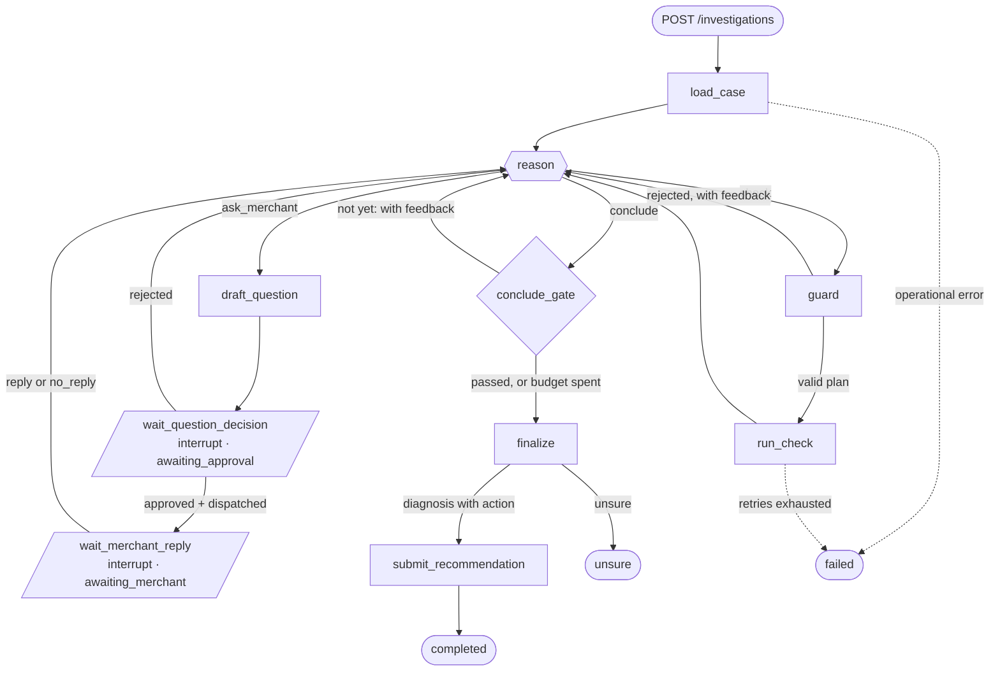

# Agent graph

v0.3 draft, Wed Nov 18, 2026. The LangGraph investigation: how the agent chooses what to check, its
state, nodes, guards, conclude gate, pause and resume, limits, and diagnostic tools. DTOs referenced here
are defined in [contracts.md](contracts.md). Facts about the data come from C-01.

The agent decides what to investigate next from the evidence. Code bounds that choice with guards and a
conclude gate, but it doesn't script a path.

## What the data can and can't show

The C-01 data sets hard limits on what any check can prove. The prompt states them, and the guards
enforce the ones that matter.

| Fact about the data                                                                                      | Consequence for the agent                                                                                                                                                      |
| -------------------------------------------------------------------------------------------------------- | ------------------------------------------------------------------------------------------------------------------------------------------------------------------------------ |
| Time slices are `daypart` values, meal periods from order time. There are no crew schedules.             | The agent can show that a problem sits in `dinner`. Linking it to a crew or shift needs a merchant answer.                                                                     |
| There is no bag data. `item_count` is the proxy for multi-bag orders.                                    | Hypotheses say "large orders, 5+ items", not "multi-bag orders". The bag mechanism can only come from `customer_comments` or the merchant.                                     |
| There is no Dasher data.                                                                                 | `dasher_handoff` can't be tested from platform data. It ends `inconclusive` with a stated gap, or it is settled by a merchant question.                                        |
| `menu_change` and `pos_change` events link to items only through their free-text `description`.          | The agent reads `event_log` descriptions to connect an event to an item or modifier, then tests that link with `compare_periods`.                                              |
| Modifiers have no IDs.                                                                                   | Filters and targets use modifier names, such as `Extra sauce`, matching `order_items.modifiers` and `mi_claims.modifier_detail`.                                               |
| Pending claims count toward rates, and claims with `review_label` of `fraud` or `not_store_fault` don't. | Every result reports `pending_claims`. A finding that rests mostly on `pending` claims is weaker evidence.                                                                     |
| `customer_comments` are free text written by customers.                                                  | Comments, read through `sample_evidence`, can suggest a hypothesis but can't measure how often something happens. They are passed to the model as data, never as instructions. |
| History covers Oct 5 to Nov 15, 2026.                                                                    | The default window is the 42 days before the case opened, which leaves room before every seeded cause.                                                                         |
| The Golden Dataset answer key sits in the `eval` schema.                                                 | No tool reads it.                                                                                                                                                              |

## Graph



The graph has one loop and no per-cause branch. Every path back into `reason` carries the new finding,
reply or rejection reason, and `reason` decides again from the full state.

## Nodes

| Node                     | Model call | Does                                                                                                                                                                                                                                                                                                                    | Next                                                 |
| ------------------------ | ---------- | ----------------------------------------------------------------------------------------------------------------------------------------------------------------------------------------------------------------------------------------------------------------------------------------------------------------------- | ---------------------------------------------------- |
| `load_case`              | No         | Reads the case, the store, and the store overview for the window. Reads the store's menu from `GET /stores/{store_id}/menu` and fills `known_items` and `known_modifiers`. Adds the overview's evidence IDs to `retrieved_evidence_ids` and passes the overview to `reason` as the first finding. Records claims excluded with `review_label` of `fraud` or `not_store_fault`. Also calls `fraud_signals` for the window, sets `suspect_cluster` when it flags any `customer_ref`, and adds its evidence IDs. Neither call counts toward the step limit. For a reopened case, loads the prior run's hypotheses and rulings, and adds the failed recheck as evidence against the cause that was acted on. | `reason`                                             |
| `reason`                 | Yes        | Assesses the latest finding, updates every hypothesis it bears on, and picks one next action with a full plan. Returns a `ReasonOutput`.                                                                                                                                                                                | by action type                                       |
| `guard`                  | No         | Applies the rules in [Guards](#guards). A rejected update or plan goes back to `reason` with the reason attached, at most twice in a row.                                                                                                                                                                               | `run_check` or `reason`                              |
| `run_check`              | No         | Calls one allowlisted read-only tool with validated arguments. Stores the plan, the result, and the evidence IDs in `retrieved_evidence_ids`.                                                                                                                                                                           | `reason`                                             |
| `draft_question`         | No         | Creates a `merchant_question` proposal through Domain's internal route. Sets status `awaiting_approval`.                                                                                                                                                                                                                | `wait_question_decision`                             |
| `wait_question_decision` | No         | Pauses with `interrupt()`. On resume, reads the decision from Domain.                                                                                                                                                                                                                                                   | approved: `wait_merchant_reply`. rejected: `reason`. |
| `wait_merchant_reply`    | No         | Sets status `awaiting_merchant` and pauses. On resume, reads the reply from Domain. The reply becomes evidence with an `EV-RPL` ID.                                                                                                                                                                                     | `reason`                                             |
| `conclude_gate`          | No         | Checks the conclusion against the [conclude rules](#conclude-gate).                                                                                                                                                                                                                                                     | `finalize` or `reason`                               |
| `finalize`               | Yes        | Writes the `InvestigationResult`. Cited IDs must be in `retrieved_evidence_ids` and pass Domain's resolve check, and the action must come from the catalog.                                                                                                                                                             | `submit_recommendation` or status `unsure`           |
| `submit_recommendation`  | No         | Creates the `intervention` or `handoff` proposal through Domain's internal route. Approval is then tracked on the proposal, not the graph.                                                                                                                                                                              | end, status `completed`                              |

The model never calls write endpoints. Proposals are created only by the deterministic `draft_question`
and `submit_recommendation` nodes, after validation.

## How `reason` works

Each turn, the model receives:

- **The case and store.** The trigger, window, timezone, and exclusions. Also the store's menu: item IDs, item names and modifier names, so filters use values that exist.
- **The data limits.** The table above, so the model knows what no check can prove.
- **The hypotheses.** Every hypothesis with its status, evidence and rationale, plus causes ruled out in a prior run. On a new case the list starts empty, and the first turn opens at least two.
- **The latest result.** Its headline, metrics and notes in full, plus at most 20 of its evidence IDs and the total count. These are the first 20 in the order the Domain Service returns them, which puts the most concentrated group's newest records first. See "Evidence ID ordering" in [contracts.md](contracts.md#evidence-id-ordering). Every returned ID still goes into `retrieved_evidence_ids`. To cite records from another group, the agent runs `sample_evidence` filtered to that group. On the first turn, this is the store overview from `load_case`. Earlier checks appear as their plan and headline only.
- **Pending feedback.** Any rejection from `guard` or `conclude_gate`.
- **Budget.** Steps left, questions left, and whether a question is open.
- **Untrusted text.** `customer_comments` and merchant reply `text` are quoted and marked as data.

The system prompt asks for a fixed discipline, not a fixed path:

1. **Keep competing hypotheses open.** Start from the overview with at least two plausible causes. Never investigate only one.
2. **Assess the finding.** State in one to three sentences what the latest result shows and how reliable it is. Note the pending share and any insufficient groups.
3. **Update every hypothesis it bears on.** Mark each one supported, contradicted, unchanged or newly added, with a one-sentence rationale.
4. **Choose the most informative next step.** Pick the check whose possible results would best separate the leading hypotheses. Before the call, state what each result would mean.
5. **Explain every event near the rise.** Any `menu_change`, `pos_change`, `store_downtime` or `promotion` event close to the start of the rise is a candidate until a check rules it out.
6. **Try to disprove the leader.** Before concluding, run at least one check that would expose the leading cause if it were wrong.
7. **Ask the merchant only when it pays off.** That means an answer could separate hypotheses that platform data can't, such as how large orders are bagged, how bags reach the Dasher, or whether a crew changed.

### `ReasonOutput`

```python
class HypothesisUpdate(BaseModel):
    hypothesis_id: str | None            # None adds a new hypothesis
    cause_category: cause_category       # "other" requires a specific statement
    statement: str
    status: hypothesis_status            # open, supported, ruled_out, inconclusive
    add_supporting: list[str] = []       # evidence IDs from retrieved_evidence_ids
    add_contradicting: list[str] = []
    rationale: str                       # one sentence

class Expectation(BaseModel):
    hypothesis_id: str
    if_true: str                         # e.g. "dinner 5+ item orders at 3x or more the store rate"
    if_false: str

class CheckPlan(BaseModel):
    kind: Literal["explore", "test", "challenge"]
    tool: tool_name
    args: dict                           # validated against the tool's request model
    purpose: str                         # one sentence, shown in the UI
    discriminates: list[str] = []        # hypothesis IDs this check can separate
    expectations: list[Expectation] = []
    challenges: str | None = None        # hypothesis ID, required when kind == "challenge"

class NextAction(BaseModel):
    type: Literal["check", "ask_merchant", "conclude"]
    check: CheckPlan | None = None
    question_text: str | None = None
    why_asked: str | None = None         # which hypotheses the answer separates
    leading_hypothesis_id: str | None = None   # required when type == "conclude"

class ReasonOutput(BaseModel):
    assessment: str
    hypothesis_updates: list[HypothesisUpdate]
    matched: dict[str, Literal["if_true", "if_false", "neither"]] = {}  # for the latest check
    reply_claims: list[str] = []         # merchant statements still to verify
    next_action: NextAction
```

Check kinds:

- **`explore`** looks broadly, such as a first breakdown of claims by item or a read of the event log. It needs no hypotheses. At most three per run.
- **`test`** separates named hypotheses and states what each would predict.
- **`challenge`** targets the leading hypothesis with a result that would expose it if it were wrong. Examples: did orders without the suspect modifier rise too, did the rise start before the suspected event, or does the pattern outlast a promotion?

## Guards

`guard` checks every `ReasonOutput` before anything runs or is saved:

| Rule                                                                                                                  | Why                                                                                                                                   |
| --------------------------------------------------------------------------------------------------------------------- | ------------------------------------------------------------------------------------------------------------------------------------- |
| Cited evidence IDs must be in `retrieved_evidence_ids`                                                                | No invented evidence                                                                                                                  |
| `supported` needs a `test` or `challenge` check with sufficient data whose result matched that hypothesis's `if_true` | No support from thin data or from exploration alone                                                                                   |
| `ruled_out` needs a sufficient-data check that listed the hypothesis in `discriminates`, plus a rationale             | No silent drops. A flat result cites the check, since no rows sit behind it.                                                          |
| `dasher_handoff` can't be `supported` or `ruled_out` from platform checks                                             | There is no Dasher data. A merchant reply plus consistent platform data can only move it to `inconclusive` or into the result's gaps. |
| A cause ruled out in a prior run stays ruled out unless new contradicting evidence is cited                           | Reopening doesn't erase earlier findings                                                                                              |
| A merchant reply alone can't make a hypothesis `supported`                                                            | Replies are weighed against platform evidence, as the sprint plan requires                                                            |
| A `test` or `challenge` check must name hypotheses and expectations                                                   | Every focused check has a stated reason                                                                                               |
| The same tool with the same arguments can't run twice. This includes the `store_overview` and `fraud_signals` calls made by `load_case`. | No loops on repeated checks                                                                                                           |
| Filter values must exist: known item IDs, menu modifier names, dates within the store's data                          | Domain would reject them with `VALIDATION_ERROR`, which would waste a step                                                            |
| `explore` checks are capped at 3                                                                                      | Exploration must turn into testing                                                                                                    |

A rejected output returns to `reason` with the failed rule named. After two rejections in a row, the
graph goes to `finalize`, which must return `unsure` and list the failure as an evidence gap.

## Conclude gate

A `diagnosis` passes when all of these hold:

1. **The leader is supported.** The leading hypothesis is `supported` under the guard rules.
2. **It survived a challenge.** At least one `challenge` check targeted it, had sufficient data, and its result didn't match `if_false`.
3. **Every rival is accounted for.** Each other hypothesis is `ruled_out`, or `inconclusive` with its gap written down.
4. **Every event near the rise is explained.** Each event that `event_log` returned within 7 days of the rise's start is tied to a hypothesis with a status.
5. **No `other` cause has an automatic action.** A cause outside the list can only be handed to an analyst.

If the gate fails and budget remains, `reason` gets the missing condition as feedback. If the budget is
spent, `finalize` may still return a diagnosis, but with confidence capped at `medium` and each unmet
condition listed as an evidence gap. With no supported leader, the result is `unsure`.

The agent proposes the most likely cause. The analyst's approval and, where asked, the merchant's reply
confirm it.

## Merchant questions and replies

- **When to ask.** An answer must be able to separate named hypotheses, or confirm one that platform data can't test. `why_asked` names them, and the analyst sees that reason when approving.
- **What only the merchant knows.** In this data, that means bagging practice for large orders, how bags reach the Dasher, crew or staffing changes by daypart, and whether a menu or POS change reached the kitchen tickets.
- **How many.** At most two per run, and one open at a time. Every question still needs analyst approval before it is sent.
- **What a reply does.** It becomes evidence, and `reason` extracts its factual statements into `reply_claims`. Statements that platform data can check are tested next. For example, if a merchant says "we fixed the mapping on Nov 10", the agent compares the periods before and after Nov 10.
- **Conflicts.** A reply that conflicts with platform data is recorded as contradicting evidence. The platform data wins, and confidence drops.
- **No reply or rejection.** `no_reply` lowers confidence on any hypothesis that depended on an answer. A rejected question is recorded, and `reason` continues without asking it again.

## Pause and resume

`thread_id` is the `investigation_id`. Checkpoints live in the `agent` schema through LangGraph's Postgres
checkpointer.

- **Pausing.** `wait_question_decision` and `wait_merchant_reply` call `interrupt()`, and the checkpoint is saved. The API returns the current status.
- **Resuming.** The frontend calls `POST /investigations/{id}/resume` after the analyst decides the question or records a reply. The request carries a fresh JWT. The node re-reads the proposal or replies from Domain and never trusts the resume body.
- **No duplicate effects.** If nothing has changed in Domain, resume returns the current view and does nothing else. A resume on a finished investigation returns 409 `INVESTIGATION_FINISHED`.
- **Restarts.** A paused investigation survives a container restart because its checkpoint is in Postgres.
- **Reopening.** After a failed recheck, Domain marks the case `reopened`. The analyst starts a new investigation with `reopen_of` set. A second failed recheck sends the case to `analyst_review`, and no third run is allowed.

## Diagnostic tools

All tools are read-only and scoped to the case's store. The Domain Service computes every number using
the rate rules in [contracts.md](contracts.md). Each description says what the tool measures and what it
can't show, because that is what the model chooses from.

| Tool                     | Measures                                                                                                                                                                                         | Can't show                                             | Domain endpoint                                        | Source tables                  |
| ------------------------ | ------------------------------------------------------------------------------------------------------------------------------------------------------------------------------------------------ | ------------------------------------------------------ | ------------------------------------------------------ | ------------------------------ |
| `store_overview`         | Overall rate, eligible orders, claims by `review_label` and `error_category`, daily trend                                                                                                        | Why the rate moved                                     | `GET /stores/{id}/overview`                            | orders, mi_claims              |
| `event_log`              | Events of every `event_type`: `menu_change`, `pos_change`, `store_downtime` and `promotion`, with `started_at`, `ended_at` and `description`                                                     | Their effect. Pair with `compare_periods`.             | `GET /stores/{id}/diagnostics/events`                  | operational_events             |
| `claim_breakdown`        | Claim share against order share, plus rate, for any grouping within any filter                                                                                                                   | Cause. Concentration is a lead, not proof.             | `POST /stores/{id}/diagnostics/claim-breakdown`        | orders, order_items, mi_claims |
| `compare_periods`        | Rate before and after a date, for a target and a control                                                                                                                                         | Whether the event caused the change, without a control | `POST /stores/{id}/diagnostics/compare-periods`        | orders, order_items, mi_claims |
| `sample_evidence`        | Up to 10 claim or cancellation records for a filter, with `customer_comments`                                                                                                                    | Frequency. Samples illustrate and don't measure.       | `POST /stores/{id}/diagnostics/evidence-sample`        | mi_claims, cancellations       |
| `cancellation_breakdown` | Cancellations grouped by `cancellation_category`, `item_id`, `daypart`, weekday or day. Categories are `item_out_of_stock`, `too_busy`, `menu_data_mismatch`, `pos_technical_error` and `other`. | M&I claims. Canceled orders never have claims.         | `POST /stores/{id}/diagnostics/cancellation-breakdown` | cancellations, orders          |
| `fraud_signals`          | Pending claims concentrated on a few `customer_ref` values                                                                                                                                       | Whether a claim is fraudulent. It flags, never judges. | `GET /stores/{id}/diagnostics/fraud-signals`           | mi_claims, orders              |
| `merchant_replies`       | Replies to this case's approved questions                                                                                                                                                        | Whether a reply is true                                | `GET /cases/{case_id}/merchant-replies`                | C-04                           |
| `action_catalog`         | Allowed interventions and handoffs                                                                                                                                                               | —                                                      | `GET /catalog/actions`                                 | C-03                           |

`claim_breakdown` groups by `item_id`, `modifier`, `daypart`, `weekday`, `item_count`, `error_category`,
`review_label` or `day`. Its `ClaimFilter` accepts `item_id`, `modifiers`, `daypart`, `weekday`, an
`item_count` range, `error_category` and `review_label`. Request shapes are `ClaimBreakdownRequest`,
`ComparePeriodsRequest`, `EvidenceSampleRequest` and `CancellationBreakdownRequest` in the contracts.

### Metric names

Every `Metric` in a `ToolResult` uses one of these names, so the prompt can rely on them. A rate is
`null` when its group has fewer than `MIN_GROUP_ORDERS` eligible orders.

| Tool | Metric `name` | `group` | `unit` | Meaning |
|---|---|---|---|---|
| `store_overview` | `claim_rate` | none | rate | Attributable claims divided by eligible orders in the window |
| `store_overview` | `claim_count` | `review_label=<value>`, all four labels | count | Claims per label, including the excluded `fraud` and `not_store_fault` claims |
| `store_overview` | `claim_count` | `error_category=<value>` | count | Attributable claims per error category |
| `store_overview` | `daily_claim_rate` | `day=<YYYY-MM-DD>` | rate | The rate for each day in the window |
| `claim_breakdown` | `claim_rate` | `<group_by>=<value>`, such as `modifier=Extra sauce` | rate | The group's attributable claims divided by its eligible orders |
| `claim_breakdown` | `claim_share` | same | share | The group's share of all attributable claims in the filter |
| `claim_breakdown` | `order_share` | same | share | The group's share of all eligible orders in the filter |
| `compare_periods` | `rate_before`, `rate_after` | `target` or `control` | rate | The rate in the period before and after `split_date` |
| `cancellation_breakdown` | `cancellation_rate` | `<group_by>=<value>` | rate | The group's cancellations divided by its placed orders |
| `cancellation_breakdown` | `cancellation_count` | same | count | The group's cancellations |
| `fraud_signals` | `claim_count` | `customer_ref=<ref>`, flagged refs only | count | Pending claims from one customer reference that the Domain Service flags as concentrated |

`event_log` and `sample_evidence` return no metrics. Their records come in `ToolResult.evidence`.

`evidence_ids` in every result arrive in the fixed order defined under "Evidence ID ordering" in [contracts.md](contracts.md#evidence-id-ordering). The `reason` prompt shows the first 20.

`POST /evidence/resolve` validates citations in `finalize`. It is not offered to the model as a tool.

`GET /stores/{store_id}/menu` is read once by `load_case`. It is not offered to the model as a tool, because the menu is already in every `reason` prompt.

A `handoff_signals` tool for Dasher events is reserved. It will be added only if a Dasher table exists.

## Example: STORE-B, dinner packing with distractors

From Nov 3, `missing_item` claims rise on `dinner` orders with 5 or more items. The seeded distractors
are a Nov 1 `menu_change` to a dessert price, a `promotion` event from Nov 3 to Nov 9 that raises order
volume, `too_busy` cancellations on Friday dinners across all six weeks, and four claims with
`review_label` `fraud`. Outcomes below follow the C-01 seed description. Exact numbers will come from
the real data.

| Turn | Check, with kind                                                                                                    | Result                                                                                                                              | Hypothesis updates                                                                                                                                                |
| ---- | ------------------------------------------------------------------------------------------------------------------- | ----------------------------------------------------------------------------------------------------------------------------------- | ----------------------------------------------------------------------------------------------------------------------------------------------------------------- |
| 1    | No check. `reason` reads the overview that `load_case` fetched.                                                     | Rate rises in early November, mostly `missing_item`. Four `fraud` claims already excluded.                                          | Opens `packing`, `menu_change`, and promotion overload as `other`. Adds `dasher_handoff`, since whole bags might be missing.                                      |
| 2    | `event_log`, explore                                                                                                | Nov 1 `menu_change` to a dessert price. `promotion` Nov 3–9.                                                                        | Both events start near the rise, so both stay candidates.                                                                                                         |
| 3    | `claim_breakdown` grouped by `item_count`, filtered to Nov 3 onward, test                                           | The `5+` bucket holds a far larger share of claims than of orders                                                                   | `packing` supported. A price change can't explain missing items on large orders, so `menu_change` is contradicted.                                                |
| 4    | `claim_breakdown` grouped by `daypart`, filtered to `item_count_min` 5 from Nov 3, test                             | Concentrated in `dinner`. `lunch` stays normal.                                                                                     | `packing` narrows to `dinner` on large orders                                                                                                                     |
| 5    | `compare_periods` for `dinner` orders with `item_count_min` 5, split Nov 10, 7 days before, 6 days after, challenge | The rate stays high after the promotion ends                                                                                        | `packing` survives. Promotion overload ruled out as the explanation.                                                                                              |
| 6    | `cancellation_breakdown` grouped by weekday, filtered to `dinner`, test                                             | `too_busy` cancellations on Friday dinners, at the same level before and after Nov 3                                                | A long-standing pattern unrelated to the rise. Recorded as contradicting overload.                                                                                |
| 7    | `sample_evidence`, claims on `dinner` orders with 5+ items, explore                                                 | `customer_comments` such as "whole second bag never arrived"                                                                        | Store-side `packing` and `dasher_handoff` both fit. Platform data can't separate them.                                                                            |
| 8    | Ask the merchant, analyst approves                                                                                  | Asks how large dinner orders are bagged and whether all bags are handed to the Dasher together                                      | Waits for the reply                                                                                                                                               |
| 9    | Reply arrives                                                                                                       | Suppose the merchant says large orders started going out in two bags this month, and the second bag is sometimes left on the shelf. | Reply supports store-side `packing`. `dasher_handoff` stays `inconclusive`, with the gap "no Dasher data".                                                        |
| 10   | conclude                                                                                                            | Gate passes. Every event near the rise is explained.                                                                                | `packing` on `dinner` orders with 5+ items, `cause_started_at` Nov 3. Recommend a packing intervention with target `daypart: ["dinner"]` and `item_count_min: 5`. |

STORE-A takes a different path through the same tools. A `claim_breakdown` grouped by `modifier` shows
that about 1 in 5 orders with the `Extra sauce` modifier gets an `incorrect_item` or `ingredient_error`
claim, while other items stay normal. The event log shows the Oct 30 `menu_change`. A `compare_periods`
challenge splits on Oct 30, with orders without the modifier as the control. The Oct 20 `store_downtime`
event and the Oct 24–26 `item_out_of_stock` cancellations are ruled out, because both end before the
rise. The drink renamed in the same Oct 30 `menu_change` shows no claim rise.

## State

```python
class InvestigationState(TypedDict):
    investigation_id: str
    case_id: str
    store_id: str
    timezone: str                        # stores.timezone
    started_by: str                      # user_id only; the JWT is never stored
    reopen_of: str | None                # prior investigation_id when the case was reopened
    prior_hypotheses: list[Hypothesis]   # from the prior run, including its rulings
    window: Window                       # start and end dates
    data_start: date                     # first date with store data
    status: investigation_status
    step_count: int                      # completed run_check calls
    explore_count: int
    excluded: ExclusionSummary           # claims with review_label fraud or not_store_fault
    suspect_cluster: bool                # set by load_case from fraud_signals; pending claims flagged for fraud review
    known_items: list[str]               # item IDs from GET /stores/{store_id}/menu, for the guard
    known_modifiers: list[str]           # available_modifiers from the same menu call
    hypotheses: list[Hypothesis]
    checks: list[CheckRecord]
    retrieved_evidence_ids: list[str]    # from the load_case overview and every check; citations must come from this list
    challenge_check_ids: list[str]
    questions_asked: int                 # cap 2
    question_open: bool
    question_proposal_id: str | None
    question_outcome: Literal["approved", "rejected", "replied", "no_reply"] | None
    reply_claims: list[str]              # merchant statements not yet verified
    guard_feedback: str | None
    gate_feedback: str | None
    consecutive_rejections: int
    next_action: NextAction | None
    result: InvestigationResult | None
    error: ErrorInfo | None
    messages: Annotated[list[AnyMessage], add_messages]

class CheckRecord(BaseModel):
    check_id: str
    plan: CheckPlan
    result: ToolResult
    matched: dict[str, Literal["if_true", "if_false", "neither"]]   # set by reason next turn
    at: datetime
```

## Limits and failure handling

| Limit                            | Value                          | When hit                               |
| -------------------------------- | ------------------------------ | -------------------------------------- |
| Checks per run                   | `AGENT_MAX_STEPS`, default 12  | Go to `finalize`                       |
| Explore checks per run           | 3                              | `guard` rejects further explore checks |
| Merchant questions per run       | 2, one open at a time          | `reason` is told asking is unavailable |
| Consecutive guard rejections     | 2                              | `finalize` returns `unsure`            |
| Retries per model or Domain call | `AGENT_MAX_RETRIES`, default 2 | Status `failed` with `error.code`      |
| Domain call timeout              | 10 s                           | Counts as a failed attempt             |

- **`failed` means an operational error**, such as Domain unavailable, the model unreachable, or retries exhausted.
- **`unsure` means the evidence can't support a cause.** It is a valid result, not an error.
- **Model calls.** Use structured output rather than forced tool choice, which `claude-opus-5-5` rejects. Set effort explicitly. Check for a `refusal` stop reason before reading the content.

## Evaluation

These go into the B-05 runner, which scores each run against C-01's `eval.golden_scenarios` as mapped in
[contracts.md](contracts.md#golden-dataset-labels):

- **Dev and holdout kept apart.** Each scenario has a `split` of `dev` or `holdout`. Prompt tuning uses `dev` scenarios only, and the scorecard reports `holdout` separately. C-05 adds three holdout stores.
- **Different paths for different stores.** STORE-A and STORE-B should reach their causes through different check sequences, and both should differ from the fixed-rule baseline.
- **Distractors handled.** For each entry in a scenario's `distractors`, the result should show it ruled out or explained. In the C-01 seed these are the Oct 20 `store_downtime`, the Oct 24–26 `item_out_of_stock` burst, the same-day drink rename, the Nov 1 dessert price `menu_change`, the Nov 3–9 `promotion`, and the Friday `too_busy` cancellations.
- **No case for borderline stores.** STORE-I and STORE-J shouldn't open a case. That's a monitor check, but it belongs on the same scorecard.
- **Plan quality.** Count the share of `test` and `challenge` checks whose result matched one of their stated expectations.
- **Challenge rate.** Count the share of diagnoses whose leading cause survived a challenge check.
- **Trace review.** For the demo, keep the two Langfuse traces for STORE-A and STORE-B, with each step's stated purpose visible.
