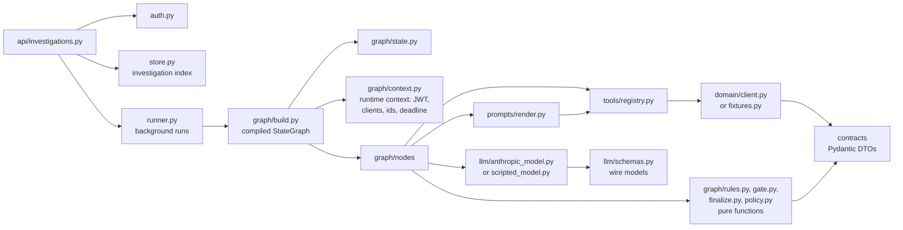
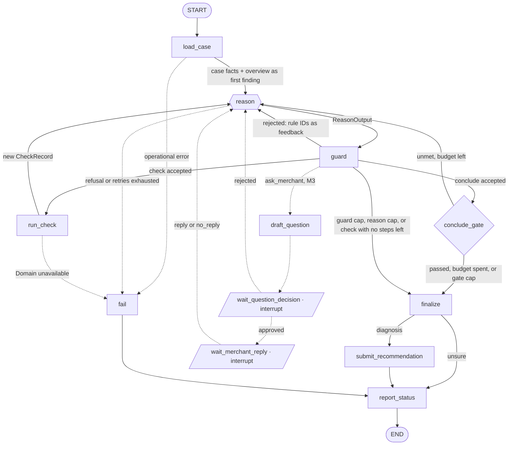
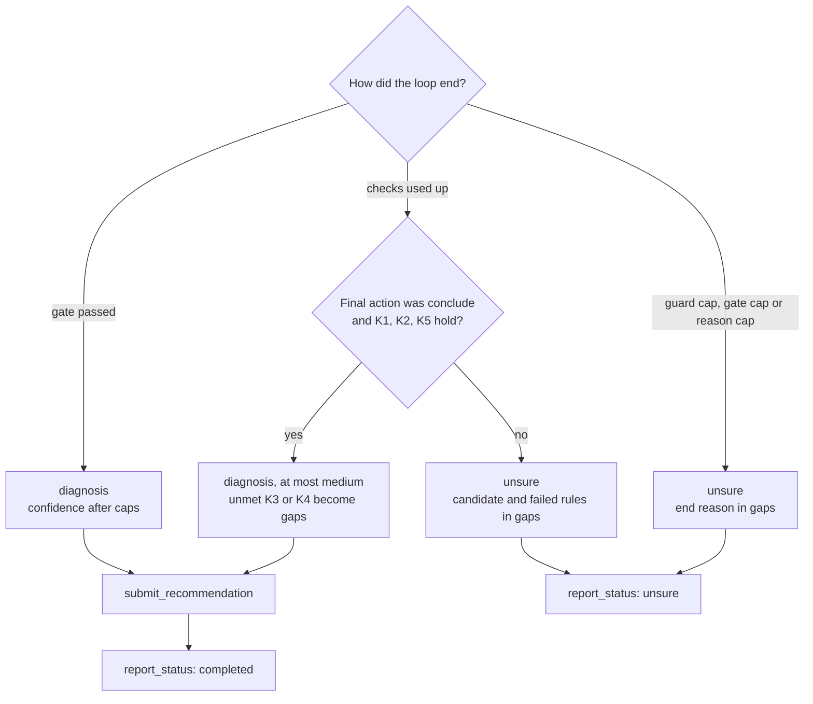
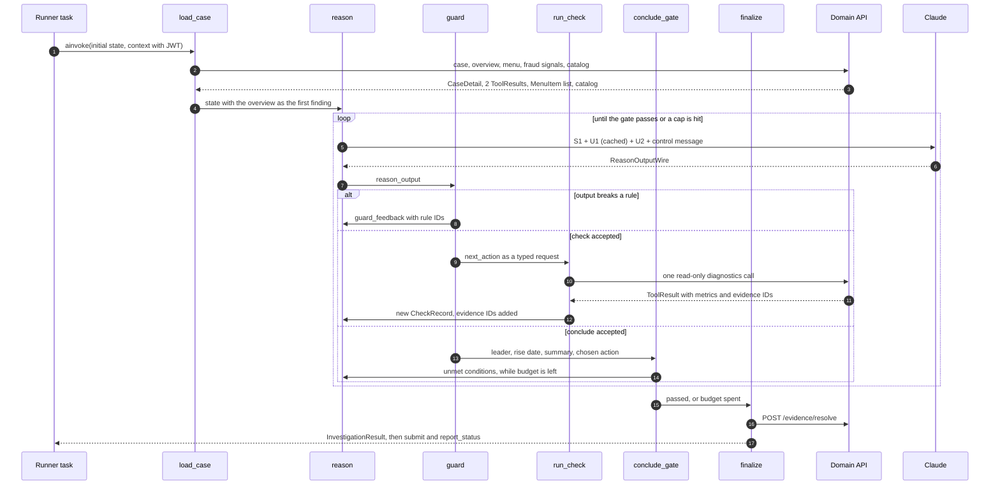
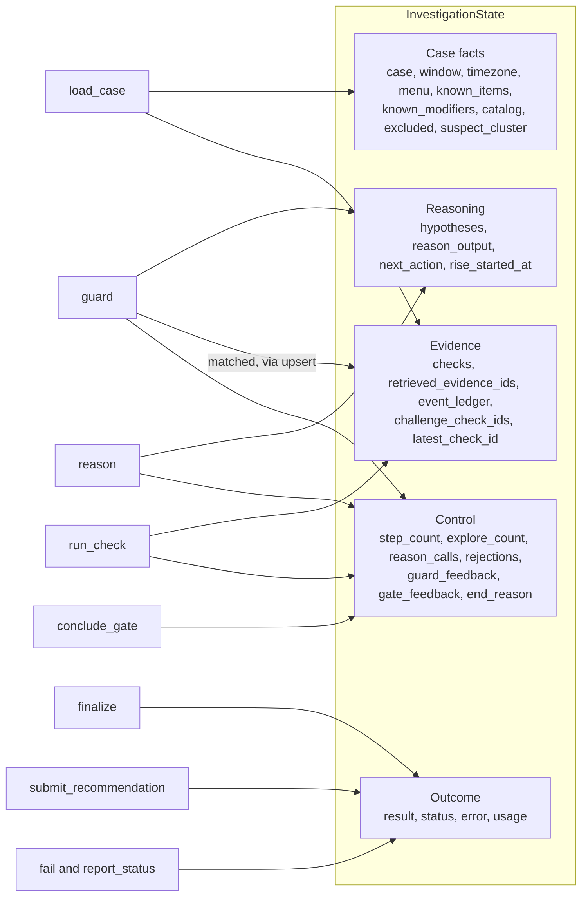
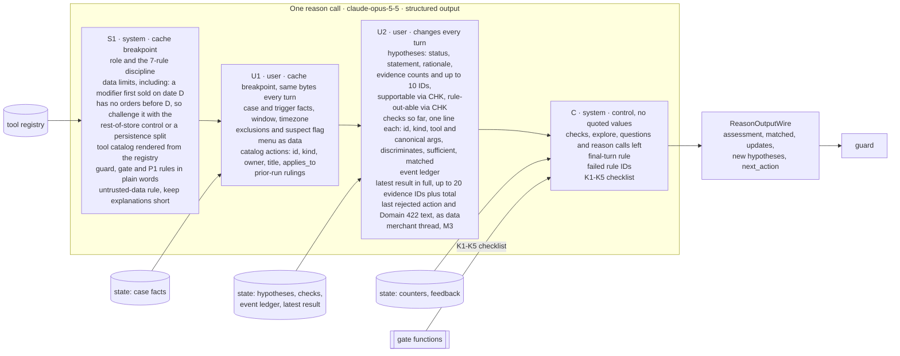
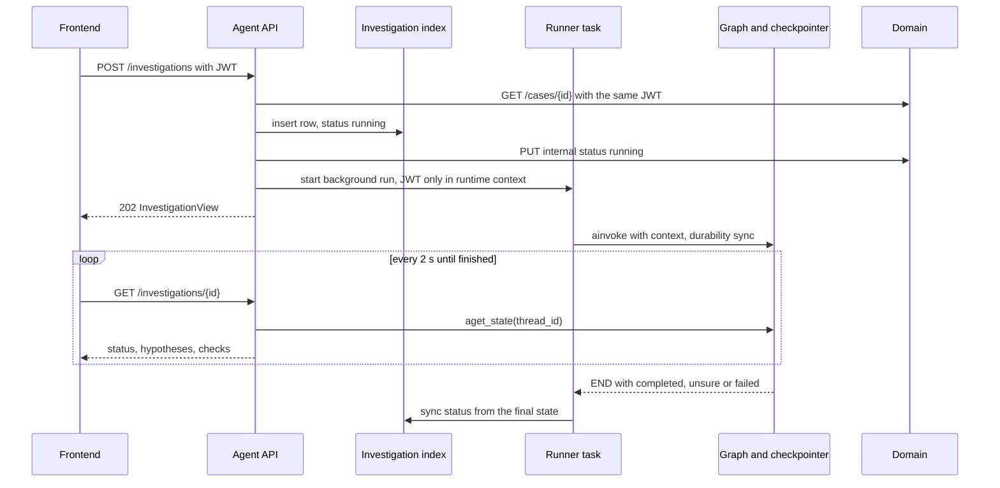

# Agent implementation plan

v0.1 draft, Wed Nov 18, 2026. How the Agent Service and its LangGraph investigation will be built. It covers
module layout, state, graph wiring, each node's inputs and outputs, tools, guardrails, context engineering,
milestones and verification. The design it implements is in [agent-graph.md](agent-graph.md), the DTOs and
endpoints in [contracts.md](contracts.md), and the service rules in [architecture.md](architecture.md).

## Scope

B-02 "Implement the core LangGraph workflow" (5 SP, due Wed Nov 18) builds the graph that B-03 (real Domain
tools) and B-04 (merchant questions, pause and resume) extend. The Thu Nov 19 POC needs one live POS case and
a distinct packing path.

B-02 acceptance criteria:
1. `POST /agent/investigations` starts a case. At least two seeded evidence patterns take distinct routes.
2. State records attempted checks, findings and ruled-out hypotheses. A configurable step limit prevents unbounded loops.
3. Insufficient evidence or exhausted checks return `unsure`. An operational failure yields a structured `failed` status and a log.

**Platform integration status:**
- Root `agent/` now runs B-02's API, graph and memory runner behind the shared JWT boundary and scoped HTTP Domain client.
- The Agent Service uses **uv**: `agent/pyproject.toml` plus a committed `agent/uv.lock`, built from the repository root so it can include `shared/`.
- Root `compose.yaml` launches `auth/`, `agent/`, `domain/` and `frontend/`, with gateway/database setup in `platform/`.
- C-02 case, store, evidence, monitor and diagnostic routers are integrated into the Domain factory.
- Service and test imports use `agent.app` / `domain.app` from the repository root; package names cannot collide.
- Memory checkpoints, scripted/fixture tests and direct Claude calls are integrated. Postgres checkpoints, merchant resumes and A-03 tracing remain separate milestones.

**Seed facts that shape the design** ([`domain/scripts/reset_and_seed.py`](../domain/scripts/reset_and_seed.py)):
- Orders get `Extra sauce` only from Oct 30. A `compare_periods` with target `modifiers=["Extra sauce"]` split on Oct 30 therefore has no "before" orders.
- The C-01 seed has no `pending` claims, so `fraud_signals` is empty and the pending caps never fire. C-02 adds pending claims, and C-05 includes a store where one `customer_ref` has 4+ pending claims.
- STORE-B adds 1–3 claims per affected order. The dinner 5+ `claim_rate` is about 0.5–0.7 claims per order.

## Key decisions

1. **The model proposes and code executes.** `reason` returns a structured `ReasonOutput` with no Claude `tool_use`. `guard` validates it and `run_check` calls Domain. The model never reaches an endpoint, and `claude-opus-5-5` rejects forced `tool_choice` anyway.
2. **The prompt is rebuilt from graph state every turn**, with no transcript or replayed thinking. Context stays focused, checkpoints stay small, prompts can be snapshot-tested, and preserved-thinking prefix rules don't apply.
3. **The JWT lives only in LangGraph's runtime context**: `StateGraph(..., context_schema=AgentContext)`, with nodes taking `runtime: Runtime[AgentContext]` and calls passing `ainvoke(..., context=...)`.
   - It is never in state or `configurable`. LangGraph's `get_checkpoint_metadata` copies every str, int, float and bool from `config["configurable"]` and `config["metadata"]` into the Postgres checkpoint metadata.
   - Each resume brings a fresh token.
4. **State values are JSON-native**, written with `model_dump(mode="json")` and read through typed accessors. LangGraph's msgpack serializer warns on unregistered custom types and blocks them under `LANGGRAPH_STRICT_MSGPACK`.
5. **`finalize` is deterministic.** The conclude action carries the narrative and the chosen catalog action. `unsure` results are built from templates. This leaves one model call per turn, one schema and one refusal point, and the confidence caps can't be argued past.
6. **`guard` sees every `ReasonOutput`**: check, ask_merchant and conclude.
7. **Every terminal path reports to Domain** through one idempotent `report_status` node, so cases don't stay stuck in `investigating`.
8. **The fixture Domain client implements the HTTP client's interface.** It is used for M1, the graph tests and the frontend. The live distinct-route evidence for the POC comes from the real Domain once C-02 lands.

## Milestones (build order)

**M0, the first hour: schema and latency spike.**
- Write `llm/schemas.py` and render one STORE-A prompt from fixtures.
- Send real calls at `low`, `medium` and `high` effort, plus one with `speed="fast"`.
- Record:
  - Whether the schema compiles. The API has an internal "Schema is too complex for compilation" limit and a 180 s compile timeout.
  - Per-turn latency and output tokens.
  - Cache reads on a second identical-prefix call.
  - Whether the SDK's beta `stream` and `parse` accept `output_format` and `fallbacks`.
- These numbers set `AGENT_EFFORT`, the demo's `AGENT_MAX_STEPS` and `AGENT_RUN_TIMEOUT_SECONDS`.
- If the schema is too complex, flatten the request union into one object with a `tool` enum and all-required per-tool sub-objects.

**M1, Wed Nov 18: the B-02 PR.**
0. Scaffold `agent/` as a uv project: `uv init`, the `uv add` commands below, a committed `uv.lock`, and the uv Dockerfile. A `/health` route runs under `uv run uvicorn`.
1. Contract models and enums. They are tolerant: the contract's "addition" fields are optional, and `baseline_rate` is nullable.
2. Tool registry, wire schemas, wire-to-contract converters and canonical keys.
3. Guard rules G1–G5, G8–G15, G18 and P1, and gate K1–K5, all as pure functions with table-driven tests. Add the finalize truth-table tests.
4. Renderers, with byte-stable snapshot tests.
5. The fixture Domain client: STORE-A, STORE-B, and a flat store that exercises `unsure`.
6. Nodes and the graph with `InMemorySaver`, plus `ScriptedReasonModel` graph tests, one per acceptance criterion (see Verification).
7. FastAPI `POST`/`GET`, the runner and an in-memory index in memory mode, with API tests through `TestClient`.
8. The Claude adapter, and a live smoke run on fixtures for STORE-A and STORE-B. It reports both check sequences and the fixture misses.
9. The doc updates, in the same PR.

**M2, Thu Nov 19: B-03 and integration, as C-02 and A-01 land.**
- The HTTP Domain client, with `respx` tests. Live runs against the real Domain are the distinct-route evidence for the POC.
- `submit_recommendation`, `/evidence/resolve`, the numbers check on the summary, and target validation.
- The Postgres checkpointer, the `agent.investigations` table and the restart reconcile, once A-01's DB init exists.
- The Langfuse hooks that A-03 builds on.

**M3, Fri Nov 20 to Sat Nov 21: B-04.** Turn questions on (G16, G17, draft, approve, reply), resume idempotency, the restart test, reopen (G6), and reply weighing (G7 and the confidence rules).

## Repo layout

A new `agent/` folder at the repo root, next to `domain/` and `frontend/`:

```
agent/
  pyproject.toml  uv.lock  .python-version  Dockerfile  .dockerignore  README.md
  app/
    main.py              # FastAPI app; lifespan: settings, clients, checkpointer, graph compile, reconcile
    config.py            # pydantic-settings; strips "+psycopg" from DATABASE_URL for psycopg/libpq
    auth.py              # minimal JWT verifier per architecture.md (A-02 may replace with shared code)
    errors.py  logging.py  cli.py  runner.py  store.py   # envelope; JSON logs + request id; CLI; background runs; index
    api/investigations.py
    contracts/           # Pydantic mirrors of contracts.md
    domain/client.py     # DomainPort protocol + HttpDomainClient (httpx.AsyncClient)
    domain/fixtures.py   # FixtureDomainClient
    tools/registry.py    # 7 model tools: wire request model, contract builder, Domain call, prompt text, canonical key
    llm/schemas.py  llm/anthropic_model.py  llm/scripted_model.py
    prompts/system.md  prompts/render.py
    graph/state.py  graph/context.py  graph/build.py
    graph/rules.py  graph/gate.py  graph/finalize.py  graph/policy.py   # pure functions
    graph/nodes/         # load_case, reason, guard, run_check, conclude_gate, finalize, submit, report_status, fail, questions (M3)
    tracing.py           # Langfuse; no-op when keys are unset
  tests/fixtures/domain/{STORE-A,STORE-B,STORE-C,common}/  tests/unit  tests/graph  tests/api
```

**How the modules connect.** The rules are pure functions. The Claude and Domain adapters each have a test double (scripted model, fixture client), so every graph test runs without the network.



**Package management: uv.**

`agent/` is a uv project:
- Created with `uv init --app --python 3.12`.
- `.python-version` is `3.12`, matching A-01's `python:3.12-slim`.
- `requires-python = ">=3.12,<3.13"`.
- `uv.lock` is committed and is the only source of exact versions.

Commands:
- Runtime dependencies:
  - `uv add fastapi==0.164.0 uvicorn==0.54.0` (versions match A-01).
  - `uv add pydantic pydantic-settings "langgraph>=1,<2" langgraph-checkpoint-postgres "psycopg[binary,pool]" "anthropic>=1,<2" httpx pyjwt python-ulid langfuse`
- Dev dependencies: `uv add --dev pytest pytest-asyncio respx`. They go to `[dependency-groups] dev`.
- Daily use: `uv sync` to set up, then `uv run pytest`, `uv run python -m app.cli …` and `uv run uvicorn app.main:app --reload`.
- After changing dependencies: `uv lock` and commit the lockfile. CI and Docker use `--locked`/`--frozen`, so a stale lock fails fast.

**Dockerfile.** Same base image, port and non-root user as A-01:
- `FROM python:3.12-slim`.
- `COPY --from=ghcr.io/astral-sh/uv:<pinned version> /uv /uvx /bin/`.
- `ENV UV_COMPILE_BYTECODE=1 UV_LINK_MODE=copy UV_PYTHON_DOWNLOADS=never`.
- Copy `pyproject.toml` and `uv.lock`, then `RUN --mount=type=cache,target=/root/.cache/uv uv sync --frozen --no-dev --no-install-project`. Dependencies get their own cached layer.
- Copy `app/`, then `uv sync --frozen --no-dev`.
- `CMD ["/app/.venv/bin/uvicorn", "app.main:app", "--host", "0.0.0.0", "--port", "8000"]`.
- Keep A-01's optional BuildKit `build_ca` secret. uv reads `SSL_CERT_FILE`, so export it in the `uv sync` step when the secret is present.
- `.dockerignore` excludes `.venv/`.

**Async clients only**, so the single worker never blocks.

## State (`graph/state.py`)

`InvestigationState(TypedDict)` follows [agent-graph.md](agent-graph.md#state).

**Added:**
- `run_config`: model, effort, speed, prompt_hash, schema_hash, registry and fixture versions, SDK version.
- `case`: the trigger window, rates and `opened_at`.
- `menu`: items, names and modifiers. Plus `catalog`.
- `event_ledger`: every event retrieved, with ID, type, local dates and description, plus the hypotheses that cite it.
- `reason_calls`, `latest_check_id`, `reason_output` (unvalidated), `gate_result`, and `gate_rejections` (a per-run total).
- `end_reason`: `gate_passed`, `budget_spent`, `guard_cap`, `gate_cap` or `reason_cap`.
- `rise_started_at`, `asked_questions`, and `usage`.

**Not kept:** `messages`. Langfuse keeps the prompts.

**Reducers:**
- `checks`: upsert by `check_id`, so `guard` can write `matched` into an existing record.
- `retrieved_evidence_ids`: order-preserving union.
- `challenge_check_ids`: append.
- Everything else overwrites. The graph has no parallel branches.

**IDs:** `INV-`, `CHK-` or `HYP-` plus a ULID, from an `IdFactory` in the context. Tests use a deterministic counter.

## Graph (`graph/build.py`)

**Topology.** Solid arrows are the B-02 graph. Dotted arrows are error paths, plus the question loop that M3 turns on.
Hexagon: the only node that calls Claude. Diamond: a deterministic checkpoint that can send the run back.



The graph has one loop and no branch per cause. Every way back into `reason` carries something new: a result,
rejection feedback or unmet gate conditions. `reason` then decides again from the full state.

**Routers:**
- Every router is a pure function of state.
- Each router checks `error` first. Every router that returns to `reason` also checks `reason_calls >= MAX_REASON_CALLS` and sends it to `finalize` with `reason_cap`.
- Nodes catch `DomainError` and `ModelError` and set `error`.
- Unexpected exceptions and timeouts are recorded by the runner with `aupdate_state(..., as_node="fail")`.
- No LangGraph `RetryPolicy`. Retries happen in one layer only: the Domain client or the Anthropic SDK.

**Invoke:**
```
ainvoke(input, config, context=AgentContext(domain, model, ids, user_id, request_id, deadline, settings), durability="sync")
```
- `config={"configurable": {"thread_id": investigation_id}, "recursion_limit": 5*MAX_REASON_CALLS + 10}`.
- `MAX_REASON_CALLS = 2*AGENT_MAX_STEPS + 4`, so the limit is 150 at the default of 12 steps.
- The limit is only a backstop. The counters are the bounds.
- `durability="sync"` saves every step before the next one.

**Finalize truth table.** Deterministic, with one test per row:

| How the loop ended | Outcome |
|---|---|
| `gate_passed` | `diagnosis`, using the conclude's confidence after the caps |
| `budget_spent`, final action conclude, and K1, K2, K5 hold | `diagnosis` at most `medium`. Unmet K3 or K4 become `evidence_gaps`. |
| `budget_spent` otherwise, `guard_cap`, `gate_cap`, `reason_cap` | `unsure`. The leading candidate and the failed rules go in `evidence_gaps`. |

The middle row reads acceptance criterion 3 ("exhausted checks return `unsure`") together with agent-graph.md's capped diagnosis. It needs Quang's approval.



**Confidence caps.**
- At most `medium` if any rival is `inconclusive`, the budget was spent, or the leader's support rests mostly on `pending` claims.
- One level lower after `no_reply`, or after a conflicting reply about the leader (M3).

## Nodes: reads, calls, writes, next

**One investigation, step by step.** Every arrow between two graph nodes is a saved checkpoint (`durability="sync"`).



**Which node writes which part of the state.** The state lives as JSON inside the checkpoint. The JWT never does.



Every node checks `context.deadline` on entry, before any write, and returns `RUN_TIMEOUT` once it has passed.

**`load_case`.** None of its calls count as steps.
- **Reads:** `case_id`, `store_id` and `reopen_of`.
- **Calls:**
  - `GET /cases/{id}`.
  - `GET /stores/{id}/overview?start&end`, where the window is the 42 days ending on the store-local date of `case.window_end`. That column is stored in UTC.
  - `GET /stores/{id}/menu`.
  - `GET …/fraud-signals` for the same window.
  - `GET /catalog/actions`.
- **Writes:**
  - `case`, `timezone`, `window` (equal to `overview.window`) and `data_start`.
  - `menu`, `known_items`, `known_modifiers` and `catalog`.
  - `excluded` and `suspect_cluster`.
  - Two uncounted check records with source `load_case`.
  - `retrieved_evidence_ids` and `latest_check_id`.
  - Emails and phone numbers are scrubbed from evidence text as it enters state.
- **Next:** `reason`, or `fail`.

**`reason`.** Claude call.
- **Reads:** the rendered prompt (see Context engineering).
- **Writes:** `reason_output`, `reason_calls` + 1, `usage`, and the raw output plus `response.model` for the call log.
- **Next:** `guard`, or `fail` on a refusal or exhausted retries.

**`guard`.** No model call.
- **On accept:**
  - Maps the new-hypothesis `ref`s to `HYP-` IDs.
  - Applies the updates and writes `matched` with an upsert.
  - Sets `next_action`, the typed request plus its canonical key, and `rise_started_at`.
  - Resets the rejection counter.
- **On reject:** writes the violated rule IDs and the offending values to `guard_feedback`.
- **Next:** `run_check`, `conclude_gate`, `reason`, `finalize`, or `draft_question` (M3).

**`run_check`.** No model call.
- **Reads:** `next_action`.
- **Calls:** one registry Domain method, with `X-Investigation-ID`.
- **Writes:**
  - Appends a `CheckRecord`.
  - `step_count` and `explore_count`.
  - Evidence IDs and the event ledger.
  - `challenge_check_ids` and `latest_check_id`.
  - A Domain 422 counts as a wasted step and is fed back as data.
- **Next:** `reason`, or `fail` when Domain is unavailable after retries.

**`conclude_gate`.** No model call.
- **Reads:** the conclude action, the hypotheses, the checks and the event ledger.
- **Writes:** `gate_result` (passed, unmet). On failure: `gate_feedback` and `gate_rejections`.
- **Next:** `finalize` or `reason`.

**`finalize`.** No model call.
- **Reads:** state plus the conclude payload.
- **Calls:** `POST /evidence/resolve` (M2).
- **Writes:** `result`, an `InvestigationResult`:
  - `cause_category` comes from the leader. `ruled_out` comes from the ruled-out hypotheses.
  - Citations must be in the retrieved set, then resolvable. Failures are dropped and become gaps.
  - The action must be in the catalog and apply to the cause. `kind`, `owner_team`, `title` and `default_recheck_days` come from the catalog, and `instructions` is filled from a template using the target.
  - The target must exist on the menu and match a supporting check's filter.
- **Next:** `submit_recommendation`, or `report_status`.

**`submit_recommendation`.** No model call.
- **Calls:** `POST /internal/cases/{id}/proposals` with `ActionContent`.
- **Writes:** `result.proposal_id`. It is checkpointed before the status call. On 409 `PROPOSAL_PENDING`, the node recovers the proposal by `investigation_id` and kind.
- **Next:** `report_status`.

**`report_status`.** No model call.
- **Calls:** `PUT /internal/cases/{id}/investigation` with `completed`, `unsure` or `failed`. The call is idempotent and retried.
- **Writes:** on failure, it sets `domain_sync_pending` on the index row. The next analyst request flushes it. The outcome itself never changes.
- **Next:** END.

**`fail`.** No model call.
- **Writes:** status `failed` and `error {code, message}`, and logs a structured error line.
- **Next:** `report_status`.

**Question nodes (M3).** The `AskMerchantAction` variant is in the schema from day 1, so `schema_hash` stays stable. G16 rejects it while `AGENT_MAX_QUESTIONS=0`.
- **`draft_question`:**
  - **Calls:** `POST /internal/cases/{id}/proposals` with kind `merchant_question`, then `report_status` `awaiting_approval`.
  - **Writes:** `question_proposal_id`, `question_open`, `questions_asked` and `asked_questions`.
- **`wait_question_decision`:**
  - **On entry:** runs only `interrupt()`, with no side effects before it, because the node re-runs on resume.
  - **On resume:** calls `GET /proposals/{id}`. Approved goes to `wait_merchant_reply` with status `awaiting_merchant`. Rejected goes to `reason`. Still pending interrupts again.
- **`wait_merchant_reply`:**
  - **On entry:** runs only `interrupt()`.
  - **On resume:** calls `GET /cases/{id}/merchant-replies` and writes the reply as `EV-RPL` evidence, plus `question_outcome`.
  - **Next:** `reason`.

## Tools (`tools/registry.py`)

Each request variant carries its own `tool` literal, because a bare `{start, end}` couldn't tell `store_overview`
from `fraud_signals`.

| Tool | Wire request (after `tool`) | Domain call |
|---|---|---|
| `store_overview` | `start, end` | `GET /stores/{id}/overview`. Already run by `load_case`. |
| `event_log` | `start, end, event_type[]` (empty means all) | `GET …/diagnostics/events` |
| `claim_breakdown` | `filter: ClaimFilter, group_by` | `POST …/claim-breakdown` |
| `compare_periods` | `split_date, days_before, days_after, target, control_mode (rest_of_store or scope), control` | `POST …/compare-periods` |
| `sample_evidence` | two variants: `evidence_type: "claim"` with `filter: ClaimFilter`, or `"cancellation"` with `filter: CancellationFilter`, plus `limit` | `POST …/evidence-sample` |
| `cancellation_breakdown` | `filter: CancellationFilter, group_by` | `POST …/cancellation-breakdown` |
| `fraud_signals` | `start, end` | `GET …/fraud-signals`. Already run by `load_case`. |

- **Wire filters** use empty lists and `0` for "no constraint". One converter builds the contract requests: empty values are omitted, and `rest_of_store` becomes `control: null`.
- **Canonical key:** the tool plus the normalized arguments. It is used for the duplicate rule and rendered in the check history.
- **Not model tools:** menu, catalog, merchant replies, evidence resolve, proposals and status.
- **The registry renders the prompt's tool section:** what each tool measures, what it can't show, its arguments and its metric names. Prompt and code can't drift apart. The text includes two rules from the contracts:
  - `claim_breakdown` by `modifier`: claims with no `modifier_detail` form no group, the note gives their count, and the shares don't add up to 1.
  - `fraud_signals`: lists only a `customer_ref` with at least `FRAUD_MIN_PENDING_CLAIMS` (default 4) pending claims in the window. An empty result means no ref reached that bar, not that no claim is fraudulent.
- **Dates** are store-local everywhere: the window, every date filter, `split_date`, `rise_started_at`, the G11 checks and the dates shown in the prompt. That matches the day rule in [contracts.md](contracts.md#conventions).

## Guardrails

**Guard rules.** A rejection names the rule IDs. Any quoted values go in U2 as data, never in the system message.

| # | Rule |
|---|---|
| G1 | Cited IDs are in `retrieved_evidence_ids` |
| G2 | Update IDs exist. New hypotheses come only from `new_hypotheses`, each with a `ref` the same output can use. `other` needs a specific statement. To narrow a hypothesis, update its statement rather than open a new one. |
| G3 | `supported` needs a sufficient test or challenge check with `matched[h] == if_true`, from a tool that returns rates. `event_log` and `sample_evidence` always report enough data, so they never count. |
| G4 | `ruled_out` needs a sufficient check listing h in `discriminates`, with `matched[h] == if_false`, plus a rationale. As in G3, the check must come from a tool that returns rates. |
| G4b | `inconclusive` needs a discriminating check that was insufficient or matched "neither", or a data-limit cause such as `dasher_handoff` |
| G5 | `dasher_handoff` is never `supported` or `ruled_out` |
| G8 | At least two hypotheses exist after the first turn |
| G9 | `matched` covers exactly the latest check's expectations while that check is unmatched, and is empty otherwise |
| G10 | Args are valid against the contract request: `days` 1–28, `limit` 1–10, start ≤ end, weekday 0–6, item count min ≤ max |
| G11 | Values exist: items and modifiers, matched case-insensitively and normalized to the menu's spelling, and dates inside the window, including `compare_periods` spans |
| G12 | A test or challenge names hypotheses and an expectation for each. `challenges` is among them, and its status is `open` or `supported`. |
| G13 | Fewer than 3 explore checks |
| G14 | The canonical key hasn't run before, including `load_case`'s calls |
| G15 | A check needs `step_count < AGENT_MAX_STEPS`. Otherwise the run goes to finalize with `budget_spent`. |
| G18 | Conclude: the leader exists, `rise_started_at` is inside the window, the action is in the catalog and applies to the cause, and the target's values exist |
| P1 | Output policy on the free text: the summary, rationale and question. No requests for refunds, credits, store charges, deactivation, menu edits or customer contact. No URLs, emails, phone numbers or `customer_ref` values. A hit is rejected and traced as `blocked_action`. |
| G6, G7, G16, G17 | Prior-run rulings, reply-only support, question availability and question content. All M3. |

**Conclude gate:**
- **K1.** The leader is `supported`.
- **K2.** A challenge has `challenges == leader`, is sufficient, comes from a tool that returns rates, and has `matched[leader] == if_true`. Its signature (tool, group_by and filter keys) must differ from every check that supported the leader.
- **K3.** Every rival is `ruled_out`, or `inconclusive` under G4b with its gap written down.
- **K4.** An all-types `event_log` covered `rise_started_at` ± 7 days. Each event overlapping that span must be cited by a rival that has a status, or by the leader if both hold:
  - The event's type fits the cause: `menu_change` or `pos_change` for `pos_modifier_mapping` and `menu_change`.
  - It starts within ±1 day of `rise_started_at`.
- **K5.** An `other` cause can only end in an analyst handoff.

**Loop bounds:**

| Bound | Value | When hit |
|---|---|---|
| Checks | `AGENT_MAX_STEPS` (12; demo value from M0) | final turn, then `budget_spent` |
| Explore checks | 3 | G13 rejects |
| Consecutive guard rejections (parse errors included) | 2 | `guard_cap`, so `unsure` |
| Gate rejections per run | 2 | `gate_cap`, so `unsure` |
| Reason calls | `MAX_REASON_CALLS` | `reason_cap`, so `unsure` |
| Wall clock | `AGENT_RUN_TIMEOUT_SECONDS`, set from M0's p95 | `RUN_TIMEOUT`, so `failed` |
| Retries | `AGENT_MAX_RETRIES`, in one layer | `failed` |
| Timeouts | Domain 10 s; Claude 180 s stall timeout (streaming) | counts as a failed attempt |

**Boundaries:**
- The API checks the JWT, role and store grant. Domain calls forward the user's JWT.
- `X-Service-Token` is sent only on `/internal/` routes.
- The model never writes. Only `submit_recommendation` (and `draft_question` in M3) create proposals, after the guard, the gate and finalize have validated them.
- No token in state, logs or traces.

**Untrusted text.** Every Domain-supplied string is rendered as escaped data inside tagged blocks in U1 and U2, capped at 300 characters. That covers `customer_comments`, reply text, event descriptions, menu and modifier names, headlines, notes and group labels. The system-role message carries only counters, rule IDs and computed checklists.

**Investigation `error.code` values:**
- From contracts.md: `UPSTREAM_UNAVAILABLE` (Domain or model unreachable after retries), `UNAUTHENTICATED` and `INTERNAL`.
- Added: `DOMAIN_REJECTED`, `MODEL_REFUSED`, `MODEL_TRUNCATED`, `RUN_TIMEOUT` and `AGENT_RESTARTED`.

## Context engineering (`prompts/`, `llm/`)

**How one `reason` call is assembled.** S1 and U1 are byte-identical on every turn of one investigation, so they
are cached. Only U2 and the control message change.



**Request:**
- `claude-opus-5-5` with `output_config={format: ReasonOutputWire, effort: AGENT_EFFORT}`, `max_tokens` 32000, adaptive thinking (default), no tools and no sampling parameters.
- It goes through `client.beta.messages.stream(..., output_format=…)` plus the final message. The beta client is needed for `fallbacks: "default"` (beta `server-side-fallback-2026-07-01`); if the SDK's helper doesn't take `fallbacks`, pass it in `extra_body`. M0 confirms both.
- Check `stop_reason` first:
  - `refusal`, after the fallback chain: `MODEL_REFUSED`.
  - `max_tokens`: one retry at 64000, then `MODEL_TRUNCATED`.
- Store `response.model` (a fallback model can serve a turn), the usage and the raw JSON for every call.

**Wire schema** (`ReasonOutputWire`). Field order is preserved because every field is required:
`assessment` → `matched` (list of `{hypothesis_id, outcome}`) → `hypothesis_updates` → `new_hypotheses` (`ref`, cause, statement, rationale, evidence) → `next_action`.
- `next_action` is a union of three variants:
  - `CheckAction{plan: CheckPlan}`.
  - `AskMerchantAction{question_text, why_asked}`.
  - `ConcludeAction{leading_hypothesis_id, rise_started_at, confidence, summary, recommendation{action_id, rationale, target}}`.
- `CheckPlan` = `kind, purpose, discriminates, expectations, challenges ("" if none), request`, where `request` is a union of the 8 per-tool variants.
- A converter maps the wire shape to the internal state shapes in [agent-graph.md](agent-graph.md#reasonoutput).

**Rules for the wire schema**, from the structured-outputs docs:
- `additionalProperties: false`. A `dict` can only return `{}`.
- No `oneOf`.
- At most 24 optional parameters and 16 union-typed parameters. A nullable field counts as a union.
- So every field is required and non-nullable, the schema has exactly 2 unions, and "none" is written as `""`, `[]` or `0`.
- No numeric or length constraints, because the SDK would move them client-side and raise on parse. Guard checks bounds.
- Enum values are lowercased before validation, since the API doesn't guarantee casing.
- A test snapshots the schema from `transform_schema()` in the `anthropic` package (check the import path) and asserts the union and optional counts. Its hash is `schema_hash`.

**Caching:**
- Breakpoints on S1 and U1. From turn 2, `cache_read_input_tokens` should cover both.
- Effort and `speed` stay fixed for a run, because changing them invalidates the cache.
- There's no second schema, since finalize makes no model call.

**Latency:**
- M0 sets the effort. Start at `medium`, which is Opus 5.5's default; architecture.md says `high`.
- Optional `speed="fast"` for the demo, at about 2× the price.
- Set step and timeout values from the measurements, and pre-run both demo cases with saved traces as a fallback.

**Reproducibility (B-05):**
- `run_config` records the hashes listed under State.
- The raw outputs are saved as cassettes that `ScriptedReasonModel` can replay.
- Each B-05 scenario runs at least 3 times, because outputs vary without sampling controls.

## API, runner, persistence

**How the API runs the graph.** The POST returns at once, and the graph keeps running in a background task. The frontend polls, and every poll reads the latest checkpoint.



**`POST /investigations`:**
- **Role:** `loe_analyst`; anyone else gets 403 `FORBIDDEN`.
- **Case lookup:** `GET /cases/{id}` with the user's JWT. A case hidden by store scope returns 404 `CASE_NOT_FOUND`. Also check the store against the token's grants.
- **409s:** `REOPEN_NOT_ALLOWED` per the contract.
- **Token lifetime:** a token expiring before the measured p95 run time gets 401 `UNAUTHENTICATED`.
- **Concurrency:** a per-case `asyncio.Lock` plus the index insert prevents two runs on one case. Postgres mode adds a partial unique index on active statuses. A clash returns 409 `INVESTIGATION_ACTIVE`.
- **Status:** a best-effort `PUT running`. A failure sets `domain_sync_pending`.
- **Run:** start the background run and return 202 with an `InvestigationView`.

**`GET /investigations/{id}`:**
- Read the row and check the store grant. Outside the grants, return 404.
- Build the `InvestigationView` from `aget_state`.
- `pending_proposal_id` is the open question while awaiting approval, or the recommendation's proposal once completed.
- On analyst requests, flush `domain_sync_pending`.

**Other routes:**
- `GET /investigations?case_id=` lists the permitted rows, newest first.
- Resume comes in M3.
- `/health` doesn't touch the DB or Domain. `/ready` does.
- Every route uses the contracts error envelope.

**Headers on Domain calls:**
- `Authorization`, forwarded.
- `X-Request-ID`, minted when the gateway didn't set one.
- `X-Investigation-ID`.

**Runner:**
- A task registry.
- `wait_for(deadline + 30 s)` as a backstop.
- On an exception: `aupdate_state` as `fail`, update the row, and attempt a status report.
- The row is synced after each run segment.

**Startup reconcile (Postgres mode):**
- For each `running` row, read `aget_state`.
- A terminal state syncs the row. Anything else becomes `failed AGENT_RESTARTED`.
- In memory mode, nothing survives a restart.

**Persistence (M2):**
- `AsyncPostgresSaver` (`langgraph.checkpoint.postgres.aio`) on a psycopg `AsyncConnectionPool` with `kwargs={"autocommit": True, "row_factory": dict_row}`.
- Role `agent_svc` with `options=-c search_path=agent`.
- `setup()` runs at startup and needs `CREATE` on schema `agent`.
- The index table is created with idempotent DDL.

**Environment variables** added to [architecture.md](architecture.md#environment-variables): `DATABASE_URL` for the agent, `AGENT_DOMAIN_MODE` (`http` or `fixtures`), `AGENT_CHECKPOINTER` (`postgres` or `memory`), `AGENT_RUN_TIMEOUT_SECONDS` and `AGENT_MAX_QUESTIONS` (0 until M3).

## Fixtures (`tests/fixtures/domain/`)

- **Files:**
  - Per store: `case.json`, `menu.json`, `overview.json`, `fraud_signals.json` and `checks.json`, a list of `{match, result}`.
  - Shared: `common/catalog.json`.
- **Numbers** follow the seed facts above and the contracts' rules: no group for claims without a `modifier_detail`, with a note giving their count, and store-local dates. STORE-C is a flat store, used for a live `unsure` run.
- **Fraud path:** a separate `fraud_signals` fixture with one flagged `customer_ref` drives the `load_case` test for `suspect_cluster`. Real data covers this path once C-02 adds pending claims to the seed.
- **Matching** keys on the tool, `group_by` and the filter dimensions, not exact dates.
- **Misses:** an unmatched query returns `data_sufficient: false` with a "no fixture" note. The smoke report counts the misses.
- **Frontend use:** `AGENT_DOMAIN_MODE=fixtures` lets the frontend drive real investigations through the gateway before C-02 is ready.
- **Expected routes.** The model picks every step at run time, so these routes are illustrative. Acceptance criterion 1 needs only the two sequences to differ.

```mermaid
flowchart TB
  subgraph A["STORE-A · POS modifier"]
    direction LR
    A0["overview + fraud signals<br/>loaded at start"] --> A1["event_log<br/>explore"] --> A2["claim_breakdown by modifier<br/>test"] --> A3["claim_breakdown by item_id<br/>test the drink rename"] --> A4["compare_periods<br/>Extra sauce vs rest of store<br/>challenge"] --> A5["conclude<br/>pos_modifier_mapping"]
  end
  subgraph B["STORE-B · dinner packing"]
    direction LR
    B0["overview + fraud signals<br/>loaded at start"] --> B1["event_log<br/>explore"] --> B2["claim_breakdown by item_count<br/>test"] --> B3["claim_breakdown by daypart<br/>5+ items, test"] --> B4["compare_periods split Nov 10<br/>challenge the promotion"] --> B5["cancellation_breakdown by weekday<br/>test"] --> B6["conclude packing<br/>dasher_handoff inconclusive"]
  end
```



- **`data_sufficient`** follows the per-tool rules in [contracts.md](contracts.md#when-a-result-has-enough-data).

## Tracing and logs (hooks for A-03)

The Langfuse v4 API:
- **Trace attributes:** each run segment is wrapped in `propagate_attributes(trace_name, session_id=investigation_id, user_id=started_by, tags=[store_id], metadata={…str ≤200})`.
- **Graph steps:** `CallbackHandler()` from `langfuse.langchain` goes in `config["callbacks"]`.
- **Model calls:** `start_as_current_observation(as_type="generation", model=…, input=…)`, then `.update(output=…, usage_details=…)`.
- **Tools and guard:** tool calls are spans. Rejections and `blocked_action` are events.

A-03 now supplies these hooks in `agent/app/tracing.py`, with shared JSON logs in
`shared/observability.py`. The callback and explicit observations export redacted
projections without mutating graph state. Model message content and untrusted
prose are withheld; only source-controlled `StaticPrompt` text is retained.
Without keys, tracing is a no-op. Flush/shutdown runs during Agent lifespan cleanup.
`LANGFUSE_BASE_URL` takes precedence over the legacy `LANGFUSE_HOST` alias.
JSON logs carry `request_id`, `case_id`, `investigation_id` and the active `trace_id`.
The B-02 runner must call `app.state.tracing.ainvoke` per run/resume and instrument
its direct Claude adapter; see [the integration guide](observability.md#hooks-for-the-b-02-workflow).
The A-03 read-only probe validates these hooks independently while B-02 is pending.

## Doc updates and open items

**Before C-02 work starts:** merge the B-01 v0.3 docs.

**Doc updates in the B-02 PR:**
- **agent-graph.md:**
  - The wire `ReasonOutput`: refs, the split hypothesis lists, the action union and the conclude payload.
  - Guard on every action.
  - The deterministic finalize and its truth table.
  - The guard and gate rules above, and the P1 output policy.
  - The state fields and loop bounds.
  - The `report_status` node.
- **contracts.md:**
  - The window is anchored on `case.window_end`. `opened_at` is wall-clock time and can fall after the seeded data.
  - The investigation error codes.
- **architecture.md:**
  - The new env vars and `LANGFUSE_BASE_URL`.
  - `DATABASE_URL` without `+psycopg` for psycopg.
  - The `AGENT_EFFORT` note.

**Domain (C-02, C-03):**
1. Confirm the breakdown rows of "When a result has enough data" in contracts.md.
2. Clip dates to the store's data range rather than returning 422, and report the clipped window.
3. Ship the status `PUT` with C-02, and accept a service-token-only `PUT` for terminal statuses.
4. A 409 `PROPOSAL_PENDING` should return the existing `proposal_id`.
5. Catalog contents: include an analyst handoff that applies to every cause. The seed's golden labels (`pos`, `diagnosed`, `merchant`, `ask_merchant_fix_pos_modifier_mapping`) don't match the contracts' enums or the catalog IDs. B-05 needs them aligned.
6. `/evidence/resolve` must accept the analyst's forwarded JWT.

**Platform (A-01, A-02, A-03):**
1. Root `agent/` and the uv image (`pyproject.toml`, `uv.lock`) are integrated. Build with `docker build -f agent/Dockerfile .` from the repository root; shared code requires that root context.
2. The agent's compose env (DB, JWT, service token, Domain URL, Anthropic, `AGENT_*`, Langfuse) and `depends_on: postgres`.
3. DB init: the `agent` schema and the `agent_svc` role with `CREATE`.
4. A-02's shared verifier is installed. B-02 must retain that boundary when adding routes.
5. The gateway forwards `X-Request-ID`; the Agent forwards it to Domain.
6. A-02 implements expiring JWTs and rotating HttpOnly refresh sessions; each resume uses a fresh request JWT.
7. Approval of the contract changes and the finalize truth table's reading of acceptance criterion 3.

**Frontend (D-02, D-03):**
- The `{error: {code}}` envelope. `errors.js` currently reads `detail`.
- The investigation error codes and the `pending_proposal_id` semantics.
- `AGENT_DOMAIN_MODE=fixtures` for UI work before C-02.

## Verification

**`uv sync --locked` then `uv run pytest`:**
- **Unit:** guard, gate and P1 rules, the finalize truth table, renderer snapshots, converters, canonical keys, and the schema snapshot (2 unions, 0 optional).
- **Graph tests** (scripted model and fixtures), one per acceptance criterion:
  - 1: the STORE-A and STORE-B routes differ.
  - 2:
    - Every check and ruling is recorded in state.
    - The step limit leads to `unsure`.
    - The guard cap, gate cap and reason cap each lead to `unsure`.
  - 3: Domain 503 and a refusal each give `failed`, with a structured log line.
- **API:** 401, 403, 404, 409 and 202 through `TestClient`. `POST` starts a run that finishes.

**M0 report:** whether the schema compiles, latency per effort, cache reads on turn 2, and SDK support for `fallbacks`.

**Image:** `docker build -f agent/Dockerfile .` succeeds from the repository root, with `uv sync --frozen` installing the committed lockfile.

**Live smoke run:** `uv run python -m app.cli --store STORE-A --domain fixtures`, then STORE-B and STORE-C.
- A and B reach their causes with different check sequences, and C ends `unsure`.
- Fixture misses are reported.
- `cache_read_input_tokens > 0` from turn 2.

**M2, through the gateway against the real Domain:**
- Both cases complete.
- A Viewer `POST` returns 403. Another store's case returns 404.
- Killing the container mid-run, in Postgres mode, gives `failed AGENT_RESTARTED` after reconcile.
- A Langfuse trace shows each step's purpose.
