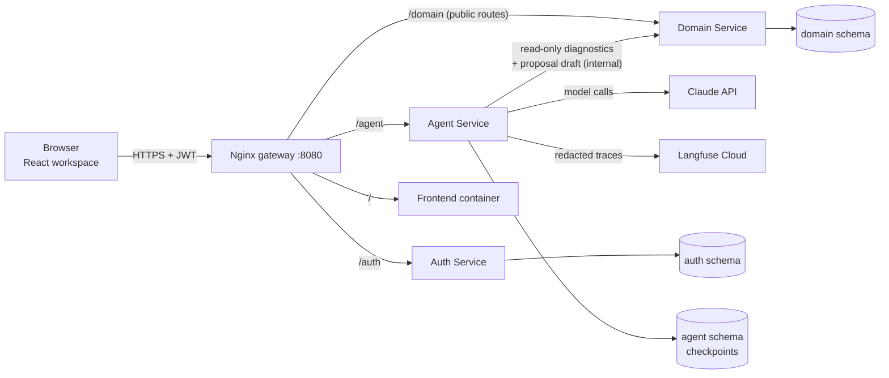
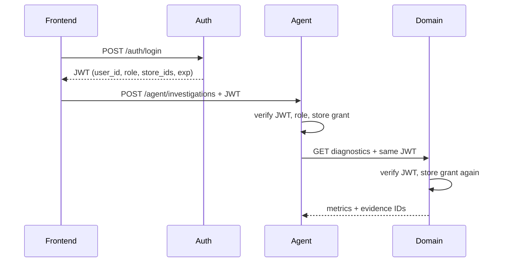

# Architecture

v0.3 draft, Thu Nov 19, 2026. Service boundaries, call directions, the auth flow, and environment
variables.

## Services and boundaries

| Service | Owns | Exposes | Calls | Must never |
|---|---|---|---|---|
| **gateway** (Nginx) | Routing, request IDs | Host port 8080. Routes `/auth/*`, `/agent/*` and `/domain/*` with the prefix stripped, and `/*` to the frontend. | All services | Hold business logic. Route `/domain/internal/*` from the browser, so it returns 404. |
| **frontend** (React) | Analyst workspace UI | Static build | Gateway only | Call a service directly, or decide permissions itself. It hides controls, but the backend enforces. |
| **auth** (FastAPI) | Accounts, roles, store grants, `auth` schema | Login and current user | Postgres | Issue a token with more stores than the user's grants. |
| **agent** (FastAPI + LangGraph) | Investigations, graph checkpoints, `agent` schema | Start, status and resume of investigations | Domain, Claude API, Langfuse | Write business data, dispatch, read the `domain` schema, or store a JWT in a checkpoint |
| **domain** (FastAPI + SQLAlchemy) | All business data, `domain` schema | Cases, evidence, diagnostics, proposals, decisions, replies, rechecks, audit | Postgres | Dispatch anything that is unapproved, stale or a duplicate |
| **postgres** | Storage | Internal only | — | Let a service role reach another service's schema |

## How the services connect

Calls only go in the directions shown. The Domain Service never calls the Agent Service. When the agent
needs to continue after an analyst decision or a merchant reply, the frontend calls the agent's resume
endpoint, and the agent then reads the new state from the Domain Service.

## Rules every service follows

- **Only the Domain Service changes business data or acts.** The agent's one write is creating a draft proposal through an internal route. A draft does nothing until an analyst approves it.
- **Every service checks the JWT itself.** The gateway checks nothing. Auth, Agent and Domain each verify the signature, expiry, role and store grant on every request.
- **The agent forwards the user's JWT unchanged** on every Domain call, so it can never act with more rights than the analyst who started the work.
- **Internal routes need a service token.** Domain routes under `/internal/` are unreachable through the gateway. They also require the `X-Service-Token` header to match `INTERNAL_SERVICE_TOKEN`.
- **No tokens in checkpoints.** Graph state stores the user ID and store ID only. Every resume arrives with a fresh token on the new request.
- **Customer and merchant text is untrusted data.** `customer_comments` and merchant reply text are passed to the model as quoted evidence, never as instructions.
- **No personal data leaves the Domain Service.** Evidence carries only the synthetic `customer_ref` from `orders`, never names, phone numbers or addresses. This keeps personal data out of model calls and Langfuse traces.
- **Every log line carries the `X-Request-ID`**, plus the `case_id` and `investigation_id` where known.
- **The answer key stays hidden.** The `eval` schema holds the Golden Dataset's expected outcomes, per C-01. Only the reset script writes it, and only the B-05 evaluation runner reads it. `agent_svc` has no rights on it, and no Domain route queries it.

## Auth flow

JWT claims, signed with HS256 and `JWT_SECRET`:

| Claim | Example | Meaning |
|---|---|---|
| `sub` | `USR-001` | User ID |
| `name` | `Ana Analyst` | Display name |
| `role` | `loe_analyst` | `viewer` or `loe_analyst` |
| `store_ids` | `["STORE-A", "STORE-B"]` | Store grants |
| `iss` | `mi-auth` | Must equal `JWT_ISSUER` |
| `iat`, `exp` | Unix seconds | Expiry is `JWT_TTL_MINUTES` after issue |

Responses: a missing, malformed or expired token gets 401. A valid token without the right role or store
gets 403.

## Environment variables

Loaded with pydantic-settings. Compose reads them from the git-ignored `.env`. Only `.env.example` is committed.

| Variable | Example | Used by | Purpose |
|---|---|---|---|
| `APP_ENV` | `local` | all | `local`, `ci` or `demo` |
| `LOG_LEVEL` | `info` | all | Log verbosity |
| `ROOT_PATH` | `/agent` | auth, agent, domain | The service's gateway prefix, so its API docs use the public path |
| `GATEWAY_PORT` | `8080` | gateway | Host port |
| `POSTGRES_DB` | `mi_agent` | postgres | Database name |
| `POSTGRES_USER`, `POSTGRES_PASSWORD` | `postgres`, `change-me` | postgres | Superuser, init only |
| `AUTH_DB_PASSWORD` | `change-me` | auth | `auth_svc` role password |
| `DOMAIN_DB_PASSWORD` | `change-me` | domain | `domain_svc` role password |
| `AGENT_DB_PASSWORD` | `change-me` | agent | `agent_svc` role password |
| `JWT_SECRET` | `change-me-32-bytes-min` | auth, agent, domain | Token signing key |
| `JWT_ISSUER` | `mi-auth` | auth, agent, domain | Expected `iss` claim |
| `JWT_TTL_MINUTES` | `60` | auth | Token lifetime |
| `INTERNAL_SERVICE_TOKEN` | `change-me-internal` | agent, domain | Guards Domain `/internal/` routes |
| `DOMAIN_SERVICE_URL` | `http://domain:8000` | agent | Internal Domain address |
| `ANTHROPIC_API_KEY` | empty | agent | Claude API key |
| `ANTHROPIC_MODEL` | `claude-opus-5-5` | agent | Model ID, recorded in every eval run |
| `AGENT_EFFORT` | `medium` | agent | Effort for the `reason` node: `low`, `medium`, `high`, `xhigh` or `max`. `medium` is Claude Opus 5.5's default; the M0 spike measures the options. |
| `AGENT_SPEED` | `standard` | agent | `standard` or `fast`. Fast mode costs about twice as much per token. |
| `AGENT_MAX_STEPS` | `12` | agent | Maximum tool checks per investigation |
| `AGENT_MAX_RETRIES` | `2` | agent | Retries per failed model or tool call |
| `AGENT_RUN_TIMEOUT_SECONDS` | `1200` | agent | Wall-clock limit per investigation. A run past it fails with `RUN_TIMEOUT`. A token that expires sooner is refused at start. |
| `AGENT_MAX_QUESTIONS` | `0` | agent | Merchant questions per run. `0` until merchant questions are on, then `2`. |
| `AGENT_MAX_REASON_CALLS` | empty | agent | Optional cap on reasoning turns. Empty means `2 * AGENT_MAX_STEPS + 4`. |
| `AGENT_DOMAIN_MODE` | `http` | agent | `http` calls the Domain Service. `fixtures` answers from the agent's fixtures, for work before C-02. |
| `AGENT_FIXTURES_DIR` | `tests/fixtures/domain` | agent | The fixture folder for fixtures mode |
| `AGENT_CHECKPOINTER` | `memory` | agent | `memory`, or `postgres` once the `agent` schema and role exist |
| `LANGFUSE_PUBLIC_KEY`, `LANGFUSE_SECRET_KEY` | empty | agent | Langfuse Cloud keys. Empty keys turn tracing off. |
| `LANGFUSE_BASE_URL` | `https://cloud.langfuse.com` | agent | Langfuse endpoint |
| `MONITOR_GOAL_RATE` | `0.05` | domain | 7-day M&I rate goal for the demo. The proposal cites 2.25% as a real-world reference. |
| `MONITOR_SPIKE_RATIO` | `1.5` | domain | Opens a case when the 7-day rate is at least this multiple of the 28-day baseline |
| `MONITOR_MIN_ORDERS` | `100` | domain | Minimum 7-day eligible orders before a store can open a case |
| `MIN_GROUP_ORDERS` | `30` | domain | Below this, a group's rate is withheld as insufficient |
| `FRAUD_MIN_PENDING_CLAIMS` | `4` | domain | Pending claims one `customer_ref` needs in the window before `fraud_signals` flags it |
| `RECHECK_DAYS_DEFAULT` | `14` | domain | Days from dispatch to recheck when the proposal gives none |

The monitor defaults follow the C-01 report, which tunes the seed so STORE-A and STORE-B cross a 7-day
rate above 5% with at least 100 eligible orders, while STORE-I and STORE-J don't. C-02 owns the final
values. A 2.25% goal could let ordinary week-to-week noise in the normal stores, which sit near 1.5%, open cases.

Each service receives its own `DATABASE_URL` in the form `postgresql+psycopg://<role>:<password>@postgres:5432/<db>`,
which Compose builds from the variables above. C-01 already reads this name. The agent's checkpointer uses
psycopg directly, so the agent drops the `+psycopg` driver suffix before connecting.
