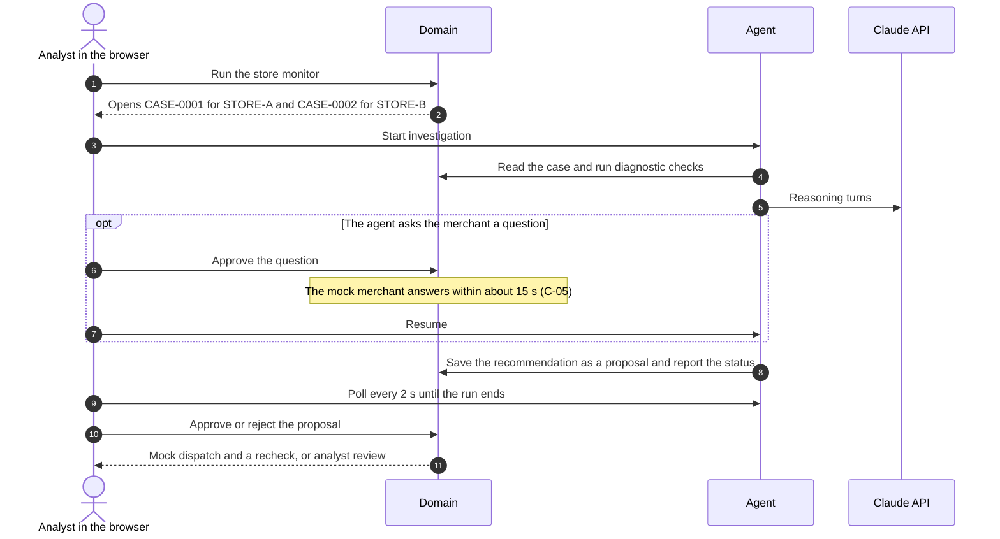

# End-to-end test guide

How to run the whole stack on your own machine and take two cases from the store monitor to an analyst's
decision: sign in, open cases, run the agent's investigation, approve or reject its recommendation, and check
the audit trail. Sections 9 and 10 add the checks for frontend work (Yibin) and Langfuse tracing (Quang).

Commands are given for **PowerShell** (Windows) and **bash** (macOS, or Git Bash on Windows). Run them from the
repo root unless a step says otherwise. The guide was last checked against `main` at `f8a7a3f` (agent B-04 and
Domain C-05) on Nov 21, 2026. If a step doesn't work for you, tell Jinfan so we can fix the guide.

Questions by area: Quang (stack, auth, tracing), Summer (Domain), Jinfan (agent), Yibin (frontend).

## Contents

1. [What you'll test](#1-what-youll-test)
2. [Before you start](#2-before-you-start)
3. [Get the code](#3-get-the-code)
4. [Configure `.env`](#4-configure-env)
5. [Start the stack](#5-start-the-stack)
6. [Seed Domain data](#6-seed-domain-data)
7. [Run the scenario in the UI](#7-run-the-scenario-in-the-ui)
8. [The same flow through the API](#8-the-same-flow-through-the-api)
9. [For Yibin: frontend integration](#9-for-yibin-frontend-integration)
10. [For Quang: Langfuse tracing](#10-for-quang-langfuse-tracing)
11. [Troubleshooting](#11-troubleshooting)
12. [Reset and clean up](#12-reset-and-clean-up)

## 1. What you'll test



Every browser and API call goes through the gateway at `http://localhost:18080`. The agent calls Domain
directly on the Docker network.

What a correct run looks like. Live model runs vary in wording, confidence and the number of checks, but the
cause and the action should match:

| Case | Store | Cause the agent should find | Recommended action | What you do |
|---|---|---|---|---|
| CASE-0001 | STORE-A | `pos_modifier_mapping` on the `Extra sauce` modifier, from about Oct 30 | `fix_modifier_mapping`, for the POS team | Approve. The case moves to `action_dispatched`, with a mock dispatch and a scheduled recheck |
| CASE-0002 | STORE-B | `packing` on large orders (5+ items), from about Nov 3 | `add_large_order_bag_check`, for the merchant | Reject. The case moves to `analyst_review` |

Either run may first ask the merchant a question, which you approve before the run goes on. To try a recheck and
a reopened case, approve CASE-0002's action instead of rejecting it ([section 8](#8-the-same-flow-through-the-api)).

## 2. Before you start

- **Docker Desktop**, running Linux containers. Check with `docker version` and `docker compose version`.
- **Git**.
- **An Anthropic API key.** Each investigation takes about 1 to 2 minutes, makes around five or six model calls
  and is billed to that key.
- **Port 18080 free** on 127.0.0.1, or set `APP_PORT` in `.env`.
- Yibin: **Node 24** for the Vite dev server and the frontend tests.
- Quang: **uv** and the team's **Langfuse Cloud** keys.

## 3. Get the code

Use `main`, which has everything this guide needs:

```bash
git switch main
git pull
```

## 4. Configure `.env`

Compose reads one `.env` in the repo root and passes each service its settings from there. The containers never
read `agent/.env` or `frontend/.env`.

1. Create it if you don't have one. If you already have a `.env` from earlier work, keep it and its database
   passwords, and only add the keys below that are missing.

   ```powershell
   if (-not (Test-Path .env)) { Copy-Item .env.example .env }    # PowerShell
   ```

   ```bash
   [ -f .env ] || cp .env.example .env                           # bash
   ```

2. Set these values:

   | Variable | Value | Why |
   |---|---|---|
   | `POSTGRES_PASSWORD`, `AUTH_DB_PASSWORD`, `DOMAIN_DB_PASSWORD`, `AGENT_DB_PASSWORD` | A new random value each | Required. Compose refuses to start without them |
   | `JWT_SECRET` | A random value of at least 32 bytes | Required. Auth, Domain and the agent all verify tokens with it |
   | `INTERNAL_SERVICE_TOKEN` | A random value | Required. Domain and the agent share it for the agent's internal writes |
   | `SEED_AUTH_ACCOUNTS`, `SEED_ANALYST_PASSWORD`, `SEED_VIEWER_PASSWORD` | Keep the example values: `true` and `Password123!` | Creates the demo logins `analyst` and `viewer` on first start. Passwords need 12+ characters |
   | `COOKIE_SECURE`, `PUBLIC_ORIGIN` | `false`, and empty | Lets login work over plain HTTP on localhost |
   | `ANTHROPIC_API_KEY` | Your key | Fill in the `ANTHROPIC_API_KEY=` line. Without the key, Start returns 503 |
   | `AGENT_EFFORT` | `medium` (optional) | The agent's own default. Compose otherwise uses `high`, which is slower and costs more |
   | `AGENT_MAX_QUESTIONS` | Leave it unset (optional) | Compose defaults to 2 merchant questions per run. Set `0` for runs without the question step |

   To generate a random value:

   ```powershell
   $b = New-Object byte[] 32; [Security.Cryptography.RandomNumberGenerator]::Create().GetBytes($b); -join ($b | ForEach-Object { $_.ToString('x2') })
   ```

   ```bash
   openssl rand -hex 32
   ```

3. Check it. This prints nothing when every required value is set:

   ```bash
   docker compose config --quiet
   ```

   Don't run it without `--quiet`: the full output shows your secrets.

## 5. Start the stack

If you've run the stack before, so the database volume already exists, first sync the database roles with your
`.env`:

```bash
docker compose up -d --wait postgres
docker compose exec postgres sh /docker-entrypoint-initdb.d/001-service-roles.sh
```

In Git Bash, prefix the second command with `MSYS_NO_PATHCONV=1` and add `-T` after `exec`.

Build and start everything. The first build takes a few minutes.

```bash
docker compose up --build -d --wait
docker compose ps
```

All six services should be healthy: postgres, auth, agent, domain, frontend and gateway. Only the gateway
publishes a host port. The images are `postgres:17-alpine` plus five built from this repo, and the containers are
named `retail-internal-ai-agent-<service>-1`. Auth creates the demo logins on this first start.

Check each service through the gateway. In PowerShell, type `curl.exe`, because `curl` is an alias there.

```bash
curl http://localhost:18080/health
curl http://localhost:18080/auth/ready
curl http://localhost:18080/agent/ready
curl http://localhost:18080/domain/ready
```

Each one answers with a short JSON body with `"status":"ok"`. `/agent/ready` should also report
`"model":"configured"` and `"domain":"ok"`. If it isn't ready, its body names the cause:
`"model":"missing ANTHROPIC_API_KEY"` means the key didn't reach the container (see
[Troubleshooting](#11-troubleshooting)), and `"domain":"unavailable"` means the agent can't reach Domain.

## 6. Seed Domain data

Compose doesn't migrate or seed Domain, and `/domain/ready` passes even on an empty database. The seed is
deterministic: 13 stores (STORE-A to M) with data from Oct 5 to Nov 15, 2026, a Nov 16 to Dec 13 snapshot that
only rechecks read, and the mock merchant's answers for STORE-A, B, L and M. It contains no cases; the monitor
opens them in section 7.

Run the seed as the Postgres admin from your `.env` (`POSTGRES_USER`, default `retail_app`, and
`POSTGRES_PASSWORD`). Then run the role script, which gives the Domain service its access back after the reset
recreates its tables. Skip the role script and every Domain route returns 503.

```powershell
# PowerShell
$env:POSTGRES_USER = 'retail_app'                          # POSTGRES_USER from .env
$env:POSTGRES_PASSWORD = '<POSTGRES_PASSWORD from .env>'
docker compose run --rm --no-deps -e POSTGRES_USER -e POSTGRES_PASSWORD domain python -m domain.scripts.reset_and_seed
docker compose run --rm --no-deps -e POSTGRES_USER -e POSTGRES_PASSWORD domain python -m domain.scripts.check_seed
docker compose exec postgres sh /docker-entrypoint-initdb.d/001-service-roles.sh
Remove-Item Env:POSTGRES_USER, Env:POSTGRES_PASSWORD
```

```bash
# bash (in Git Bash, prefix the role-script line with MSYS_NO_PATHCONV=1 and add -T after exec)
export POSTGRES_USER='retail_app'                          # POSTGRES_USER from .env
export POSTGRES_PASSWORD='<POSTGRES_PASSWORD from .env>'
docker compose run --rm --no-deps -e POSTGRES_USER -e POSTGRES_PASSWORD domain python -m domain.scripts.reset_and_seed
docker compose run --rm --no-deps -e POSTGRES_USER -e POSTGRES_PASSWORD domain python -m domain.scripts.check_seed
docker compose exec postgres sh /docker-entrypoint-initdb.d/001-service-roles.sh
unset POSTGRES_USER POSTGRES_PASSWORD
```

The seed ends with `Done: 13 stores, ...` and `Future snapshot: ... 4 mock merchant answers.`, and `check_seed`
prints row counts, integrity checks and each store's M&I rate. The seed runs from the built image, so after
pulling or changing Domain code, rebuild first with `docker compose build domain`, then seed and run the role
script again.

## 7. Run the scenario in the UI

Use one hostname for the whole test: `localhost`, not a mix with `127.0.0.1`. The login cookie is tied to the
host.

**As the analyst**

1. Open http://localhost:18080 and sign in as `analyst`, with the `SEED_ANALYST_PASSWORD` from your `.env`.
2. On the case queue, click **Run monitor**. It opens CASE-0001 (STORE-A) and CASE-0002 (STORE-B), the two
   stores the demo analyst can see.
3. Open **CASE-0001** and click **Start investigation**. The page shows the step count and polls every 2 seconds.
   A run takes about 1 to 2 minutes. If the agent asks the merchant a question, the page shows "Investigation
   paused" and "The agent wants to ask the merchant": click **Approve and send** (you can edit the wording first),
   and the page resumes the run itself. STORE-A's and STORE-B's merchants answer within about 15 seconds of the
   question being sent: if the page shows "Waiting for the merchant", wait that long, then confirm that the
   merchant replied.
4. When it finishes, read the result: the cause, the evidence (click an evidence ID to open the record), the
   causes ruled out, the gaps and the recommendation.
5. Click **Approve and send**. The case moves to `action_dispatched`, and the Activity log shows the approval,
   the mock dispatch and a scheduled recheck.
6. Open **CASE-0002**, start an investigation, and when it finishes click **Reject**. The case moves to
   `analyst_review`.

On **CASE-0001**, click **Run recheck now**. The recheck reads the seeded future snapshot (C-05) and, for
STORE-A, comes back improved, so the case moves to `closed`.

**As the viewer**

1. Click **Logout** and sign in as `viewer`, with `SEED_VIEWER_PASSWORD`. To keep both roles open, use a private
   window for one of them.
2. The queue shows only STORE-A's case, and there's no **Run monitor** button.
3. CASE-0001 opens read-only, with no Start or decision buttons.
4. Paste the CASE-0002 URL from the analyst's window. STORE-B isn't in the viewer's grants, so the page says the
   case wasn't found.

To run the scenario again, see [Reset and clean up](#12-reset-and-clean-up).

## 8. The same flow through the API

This is optional and useful for backend checks without the UI. Use it instead of section 7, on a freshly seeded
database, or reset first ([section 12](#12-reset-and-clean-up)): it starts and decides CASE-0001, and once a case
is decided, Start returns 409 `CASE_NOT_STARTABLE`.

Sign in right before you start: tokens last 60 minutes, and the agent refuses a token with less than 20 minutes
left. The examples use the demo password from `.env.example`; change it if yours differs.

<details>
<summary>PowerShell</summary>

```powershell
$Base = 'http://127.0.0.1:18080'
$login = Invoke-RestMethod -Method Post -Uri "$Base/auth/login" -ContentType 'application/json' `
  -Body (@{ username = 'analyst'; password = 'Password123!' } | ConvertTo-Json)
$H = @{ Authorization = "Bearer $($login.access_token)" }

# Open the cases (skip this if the monitor already ran since the last seed)
Invoke-RestMethod -Method Post -Uri "$Base/domain/monitor/run" -ContentType 'application/json' `
  -Headers ($H + @{ 'Idempotency-Key' = [guid]::NewGuid().ToString() }) -Body '{"as_of":"2026-11-15"}'

# Wait for a run to finish. If the agent asks the merchant a question, approve it and resume.
function Wait-Run($Id) {
  while ($true) {
    Start-Sleep 5
    $v = Invoke-RestMethod -Uri "$Base/agent/investigations/$Id" -Headers $H
    if ($v.status -eq 'running') { continue }
    if ($v.status -ne 'awaiting_approval') { return $v }
    $q = Invoke-RestMethod -Uri "$Base/domain/proposals/$($v.pending_proposal_id)" -Headers $H
    Invoke-RestMethod -Method Post -Uri "$Base/domain/proposals/$($q.proposal_id)/decision" `
      -Headers ($H + @{ 'Idempotency-Key' = [guid]::NewGuid().ToString() }) -ContentType 'application/json' `
      -Body (@{ version = $q.version; decision = 'approve'; note = 'E2E test' } | ConvertTo-Json) | Out-Null
    Start-Sleep 20  # the mock merchant answers within about 15 s of the approval (C-05)
    Invoke-RestMethod -Method Post -Uri "$Base/agent/investigations/$Id/resume" `
      -Headers ($H + @{ 'Idempotency-Key' = [guid]::NewGuid().ToString() }) | Out-Null
  }
}

# Start an investigation and wait for it to finish
$inv = Invoke-RestMethod -Method Post -Uri "$Base/agent/investigations" -Headers $H `
  -ContentType 'application/json' -Body '{"case_id":"CASE-0001"}'
$v = Wait-Run $inv.investigation_id
$v.status
$v.result | ConvertTo-Json -Depth 6

# Approve the recommendation (send "reject" for the reject path)
Invoke-RestMethod -Method Post -Uri "$Base/domain/proposals/$($v.result.proposal_id)/decision" `
  -Headers ($H + @{ 'Idempotency-Key' = [guid]::NewGuid().ToString() }) -ContentType 'application/json' `
  -Body '{"version":1,"decision":"approve","note":"E2E test"}'
Invoke-RestMethod -Uri "$Base/domain/cases/CASE-0001/audit" -Headers $H
```

Windows PowerShell 5.1 throws on any 4xx or 5xx response. To see the error body, wrap the call in
`try { ... } catch { $_.ErrorDetails.Message }`.

</details>

<details>
<summary>bash (macOS or Git Bash)</summary>

```bash
BASE=http://127.0.0.1:18080
json_field() { grep -o "\"$1\":\"[^\"]*\"" | head -1 | cut -d'"' -f4; }

# Sign in. Single quotes keep the "!" in the password safe from the shell.
TOKEN=$(curl -s -H 'Content-Type: application/json' \
  -d '{"username":"analyst","password":"Password123!"}' "$BASE/auth/login" | json_field access_token)
AUTH="Authorization: Bearer $TOKEN"

# Open the cases (skip this if the monitor already ran since the last seed)
curl -s -X POST "$BASE/domain/monitor/run" -H "$AUTH" -H "Idempotency-Key: monitor-$(date +%s)" \
  -H 'Content-Type: application/json' -d '{"as_of":"2026-11-15"}'; echo

# Wait for a run to finish. If the agent asks the merchant a question, approve it and resume.
wait_run() {
  while :; do
    sleep 5
    VIEW=$(curl -s "$BASE/agent/investigations/$1" -H "$AUTH")
    case "$VIEW" in
      *'"status":"running"'*) continue ;;
      *'"status":"awaiting_approval"'*)
        Q=$(echo "$VIEW" | json_field pending_proposal_id)
        QV=$(curl -s "$BASE/domain/proposals/$Q" -H "$AUTH" | grep -o '"version":[0-9]*' | head -1 | cut -d: -f2)
        curl -s -X POST "$BASE/domain/proposals/$Q/decision" -H "$AUTH" -H "Idempotency-Key: q-$Q-$(date +%s)" \
          -H 'Content-Type: application/json' -d "{\"version\":$QV,\"decision\":\"approve\",\"note\":\"E2E test\"}" >/dev/null
        sleep 20  # the mock merchant answers within about 15 s of the approval (C-05)
        curl -s -X POST "$BASE/agent/investigations/$1/resume" -H "$AUTH" -H "Idempotency-Key: r-$Q-$(date +%s)" >/dev/null ;;
      *) echo "$VIEW"; return ;;
    esac
  done
}

# Start an investigation and wait for it to finish (an error here prints the reason and leaves INV empty)
START=$(curl -s -X POST "$BASE/agent/investigations" -H "$AUTH" -H 'Content-Type: application/json' \
  -d '{"case_id":"CASE-0001"}'); echo "$START"
INV=$(echo "$START" | json_field investigation_id)
wait_run "$INV"
PROP=$(echo "$VIEW" | json_field proposal_id)

# Approve the recommendation (send "reject" for the reject path)
curl -s -X POST "$BASE/domain/proposals/$PROP/decision" -H "$AUTH" -H "Idempotency-Key: decide-$(date +%s)" \
  -H 'Content-Type: application/json' -d '{"version":1,"decision":"approve","note":"E2E test"}'; echo
curl -s "$BASE/domain/cases/CASE-0001/audit" -H "$AUTH"; echo
```

</details>

Other responses worth checking:

- Start returns 202 with `"status":"running"`.
- Starting again on a case with a pending proposal returns 409 `PROPOSAL_PENDING`, and on a decided case, 409
  `CASE_NOT_STARTABLE`.
- The viewer's Start returns 403 `FORBIDDEN`.
- `GET /agent/investigations?case_id=CASE-0001` lists the case's runs, newest first.
- Within about 15 seconds of a question's approval, `GET /domain/cases/{id}/merchant-replies` shows the mock
  merchant's answer, with `recorded_by` `svc_mock_merchant` and an `EV-RPL` evidence ID. The wait loop resumes 20
  seconds after the approval, so the run reads it on that resume and doesn't stop at `awaiting_merchant`, and the
  result lists it in `unverified_reply_claims`.

**Recheck and reopen (C-05).** On a fresh seed, run CASE-0002 the same way, but approve its recommendation. Then
run its recheck. STORE-B's first recheck doesn't improve, so Domain reopens the case, and one more investigation
can start with `reopen_of`:

```powershell
# PowerShell, after approving CASE-0002's recommendation; $first is that run's investigation ID
$first = $inv.investigation_id
$rk = ((Invoke-RestMethod -Uri "$Base/domain/cases/CASE-0002/rechecks" -Headers $H) | Where-Object { $_.status -eq 'scheduled' }).recheck_id
Invoke-RestMethod -Method Post -Uri "$Base/domain/rechecks/$rk/run" -Headers ($H + @{ 'Idempotency-Key' = [guid]::NewGuid().ToString() })
$inv2 = Invoke-RestMethod -Method Post -Uri "$Base/agent/investigations" -Headers $H -ContentType 'application/json' `
  -Body (@{ case_id = 'CASE-0002'; reopen_of = $first } | ConvertTo-Json)
$v2 = Wait-Run $inv2.investigation_id
```

```bash
# bash, after approving CASE-0002's recommendation; INV is that run's investigation ID
FIRST=$INV
RK=$(curl -s "$BASE/domain/cases/CASE-0002/rechecks" -H "$AUTH" | grep -o '"recheck_id":"[^"]*"' | tail -1 | cut -d'"' -f4)
curl -s -X POST "$BASE/domain/rechecks/$RK/run" -H "$AUTH" -H "Idempotency-Key: rck-$(date +%s)"; echo
START=$(curl -s -X POST "$BASE/agent/investigations" -H "$AUTH" -H 'Content-Type: application/json' \
  -d "{\"case_id\":\"CASE-0002\",\"reopen_of\":\"$FIRST\"}"); echo "$START"
wait_run "$(echo "$START" | json_field investigation_id)"
```

- The recheck returns `not_improved` with `data_sufficient: true`, and the case is `reopened` with
  `reopen_count: 1`. Start without `reopen_of` returns 409 `CASE_NOT_STARTABLE`.
- Approve the second run's recommendation and run its recheck the same way: it returns `improved`, and the case
  closes. A further `reopen_of` returns 409 `REOPEN_NOT_ALLOWED`.
- STORE-K's merchant never answers, and the demo analyst can't see that store. To try it, get a token for all
  stores (12 hours) with `docker compose run --rm --no-deps -T domain python -m domain.scripts.make_demo_token`,
  use it as the bearer token, run the monitor again, and find STORE-K's case in `GET /domain/cases`. A question
  there waits at `awaiting_merchant`. Record no reply with `POST /domain/proposals/{id}/merchant-reply`, body
  `{"outcome":"no_reply","text":null}` and an `Idempotency-Key`, then resume. The live model often concludes on
  STORE-K without asking, since it can test that store's pattern from platform data.

## 9. For Yibin: frontend integration

There are two ways to run the UI against the real backend:

| | Compose frontend | Vite dev server |
|---|---|---|
| URL | http://localhost:18080 | http://localhost:5173 |
| Good for | The real deployment path | Fast iteration with hot reload |
| After a code change | `docker compose up --build -d --wait frontend` | Reloads by itself |

For the dev server, keep the Compose stack running. Vite proxies `/auth`, `/agent` and `/domain` to
`http://localhost:18080`.

```bash
cd frontend
# copy .env.example to .env if you don't have one (see section 4 for the commands)
npm ci
npm run dev
```

Make sure `frontend/.env` has `VITE_USE_MOCKS=false` and an empty `VITE_API_URL`. While mocks are on, the sign-in
page shows a "Mock mode" line and the nav shows **Reset demo**, which clears only mock data. If the Vite terminal shows `ECONNREFUSED ::1:18080`, change the proxy target
in `vite.config.js` to `http://127.0.0.1:18080` on your machine, and don't commit that change.

Unit tests, lint and build: `npm test`, `npm run lint` and `npm run build`, from `frontend/`.

Checks against the real agent, with DevTools' Network tab open:

- [ ] **Start** sends `POST /agent/investigations` and gets 202. When the token has less than 25 minutes left, a
      `POST /auth/refresh` comes first.
- [ ] `GET /agent/investigations/{id}` repeats every 2 seconds and stops once the status is `completed`,
      `unsure` or `failed`. Then the case reloads.
- [ ] Reloading the page mid-run picks the run back up through `GET /agent/investigations?case_id=`.
- [ ] The recommendation comes from `GET /domain/proposals/{id}`, and evidence IDs open through
      `GET /domain/evidence/{id}`.
- [ ] **Approve and send** or **Reject** sends `POST /domain/proposals/{id}/decision` with the version on screen
      and a new `Idempotency-Key`, and the case and Activity log refresh.
- [ ] Start on a case with a pending proposal returns 409 `PROPOSAL_PENDING`, and on a decided case, 409
      `CASE_NOT_STARTABLE`. On a fresh load the page shows the pending proposal and no Start. After a 409 from a
      stale page, it still shows the error under Start until you reload; the goal is the fresh-load view.
- [ ] Restart the agent with `docker compose restart agent`. Runs are kept in Postgres: a finished or paused run
      comes back as it was, and a run cut off mid-step comes back `failed` with `AGENT_RESTARTED`, which the
      page shows with Start again.
- [ ] A merchant question shows as "The agent wants to ask the merchant". **Approve and send** sends
      `POST /domain/proposals/{id}/decision`, then `POST /agent/investigations/{id}/resume`, and polling picks up
      again. STORE-A's and STORE-B's merchants answer within about 15 seconds; until then the run waits at "Waiting
      for the merchant", and confirming that the merchant replied resumes it.
- [ ] After a recheck run through the API ([section 8](#8-the-same-flow-through-the-api)) and a reload, the case
      shows the recheck result, and a `reopened` case offers **Start new investigation**, which sends `reopen_of`.
      **Run recheck now (demo)** still appears only in mock mode.
- [ ] The viewer checks from [section 7](#7-run-the-scenario-in-the-ui).

## 10. For Quang: Langfuse tracing

**Configure.** Add these to the root `.env`, not `agent/.env`:

```bash
LANGFUSE_PUBLIC_KEY=pk-lf-...
LANGFUSE_SECRET_KEY=sk-lf-...
LANGFUSE_BASE_URL=https://cloud.langfuse.com    # your project's region host
LANGFUSE_TRACING_ENABLED=true
```

Then rebuild, since the agent image now installs `langfuse`: `docker compose up --build -d --wait`. Tracing is on
when `docker compose logs agent` has no `telemetry.disabled` or `telemetry.init_failed` line. There's no positive
"enabled" line, and `/agent/ready` doesn't report tracing.

**Optional quick probe**, before the full scenario:

```bash
uv sync --locked --project agent
uv run --project agent python -m agent.app.trace_poc --offline          # no keys, no network
uv run --project agent --env-file .env python -m agent.app.trace_poc    # one real Claude call, exported to Langfuse
```

The live probe exits 0 and logs `ingestion_verified=true` with a `trace_url`.

**Run the scenario** from sections 6 and 7, through the UI or the API, with the agent in its default `http` mode.
The agent CLI and the mock-mode UI produce no traces, and fixtures mode (`AGENT_DOMAIN_MODE=fixtures`) leaves out
the `domain.*` observations.

**Check in Langfuse:**

- [ ] One trace named `investigation` per start or resume, all in one session: the investigation ID. Each trace's
      metadata has `request_id`, `case_id` and `investigation_id`.
- [ ] Node spans: `load_case`, `reason`, `guard`, `run_check`, `finalize`, `submit_recommendation` and
      `report_status`, plus `conclude_gate` when the model concludes, and `draft_question`,
      `wait_question_decision` and `wait_merchant_reply` when it asks the merchant a question.
- [ ] A `reason.model` generation for each model call, with token usage, including cache reads.
- [ ] A `domain.*` tool observation for each Domain call, such as `domain.overview`, `domain.claim-breakdown`,
      `domain.resolve`, `domain.proposals` and `domain.merchant-replies`.
- [ ] Separate single-observation traces for the Start `running` report, failure reports and status resends. These
      run outside the investigation, so they're expected.
- [ ] Privacy: free text (headlines, rationales, customer comments, merchant text and prompts) shows `[REDACTED]`,
      while IDs, numbers, dates and enums stay visible. No JWT appears anywhere: searching
      `docker compose logs agent domain auth` for `eyJ` finds nothing.

**Link logs to the trace.** The run's `investigation.started` log line carries `request_id`, `case_id`,
`investigation_id` and `trace_id`:

```bash
docker compose logs --no-log-prefix agent | grep -F '"investigation.started"'
```

In PowerShell, end the command with `| Select-String -SimpleMatch '"investigation.started"'` instead. Search
Langfuse for that `trace_id`, or open Sessions and pick the investigation ID. The same `request_id` appears in the
gateway and Domain logs, and in the tooltip of the case's Activity log entries.

For the A-03 acceptance evidence, keep a trace URL and the matching JSON log lines for both cases, following the
checklist in `docs/observability.md`.

## 11. Troubleshooting

| Symptom | Cause and fix |
|---|---|
| `required variable ... is missing a value` | A required key is missing from the root `.env`. Add it ([section 4](#4-configure-env)) |
| `/agent/ready` returns 503 naming `ANTHROPIC_API_KEY`, or Start returns 503 | The key isn't in the root `.env`. Add it, then run `docker compose up -d agent`. A plain restart keeps the old settings |
| Domain routes return 503 after seeding, or after pulling new Domain code | The role script didn't run after `reset_and_seed`, or new tables lack its grants. Rebuild Domain, seed and run it ([section 6](#6-seed-domain-data)) |
| Right after restarting Domain or the agent, `/domain/ready` answers with the agent's body, or `/agent/ready` returns 502 | The containers got new addresses, and the gateway looks them up again every 10 seconds. Wait a few seconds and retry, or run `docker compose restart gateway` |
| The agent never asks a merchant question | Questions are off while `AGENT_MAX_QUESTIONS=0`, or when Domain has no merchant-replies route (an image built before C-05: rebuild Domain). The model also asks only when an answer would separate causes that platform data can't |
| The queue is empty | The seed has no cases. Click **Run monitor**. If the monitor opens nothing, the cases are already open or Domain isn't seeded |
| The seed hangs at "Resetting schemas" | Stop Domain first with `docker compose stop domain`, seed, then `docker compose up -d --wait domain` |
| Login fails with `INVALID_CREDENTIALS` | The demo accounts keep the password they were first created with. Use that one, or start over with `docker compose down -v` |
| Login returns 403 "Cross-site authentication request denied" | Leave `PUBLIC_ORIGIN` empty, and use one hostname for the whole test |
| Start returns 401 | The token has less than 20 minutes left. Sign in again |
| Start returns 409 `PROPOSAL_PENDING` | Decide the case's pending proposal first |
| Start returns 409 `CASE_NOT_STARTABLE` | The case was already decided. Reset to run it again ([section 12](#12-reset-and-clean-up)) |
| Polling returns 404 | The agent restarted with `AGENT_CHECKPOINTER=memory`, which drops its runs. Compose's default, `postgres`, keeps them. Start a new run |
| The sign-in page shows "Mock mode" | Set `VITE_USE_MOCKS=false` in `frontend/.env` and restart `npm run dev` |
| Postgres exits right after its first start on a new volume (macOS or Linux) | Run `docker compose up --build -d --wait` again; the second start skips first-time setup. Then run the role script once |
| Git Bash mangles `/docker-entrypoint-initdb.d/...` or says the input isn't a TTY | Prefix the command with `MSYS_NO_PATHCONV=1` and add `-T` after `exec`, or use PowerShell |
| `curl` in PowerShell behaves oddly | It's an alias for `Invoke-WebRequest`. Type `curl.exe` |

## 12. Reset and clean up

- **Run the scenario again:** reseed Domain ([section 6](#6-seed-domain-data)), then clear the agent's runs,
  which Postgres keeps across restarts and which would point at the old cases:
  `echo "TRUNCATE agent.checkpoints, agent.checkpoint_blobs, agent.checkpoint_writes;" | docker compose exec -T postgres sh -c 'psql -U $POSTGRES_USER -d $POSTGRES_DB'`
  (the same in bash and Windows PowerShell) and `docker compose restart agent`. Then click **Run monitor** again. Clear the runs only together with a
  reseed: clearing them partway through a scenario makes a later `reopen_of` return 409 `REOPEN_NOT_ALLOWED`.
- **Stop:** `docker compose down` keeps the database.
- **Start over completely:** `docker compose down -v` deletes the database volume. The next `up` recreates the
  roles and the demo logins; then seed Domain again.
- **Also remove the built images:** `docker compose down -v --rmi local`.
