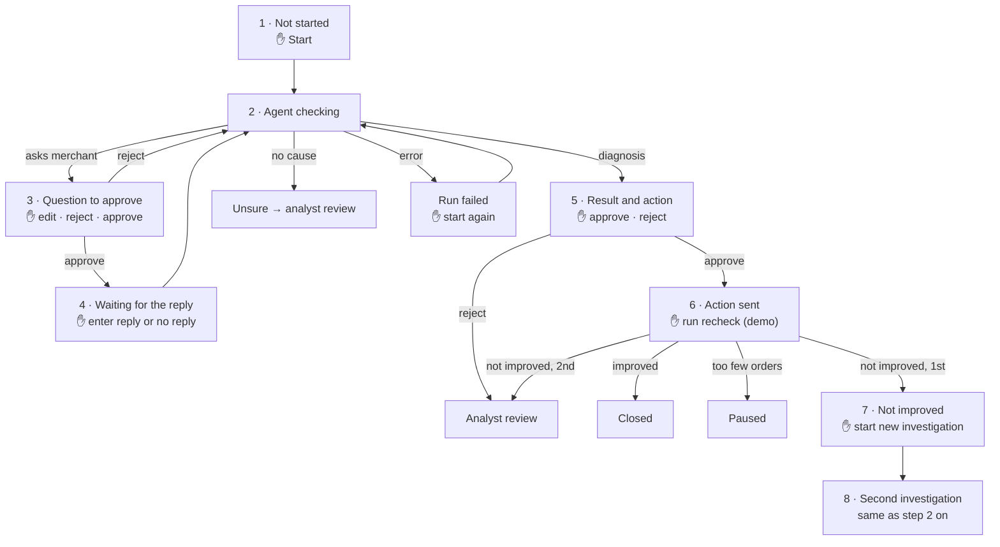
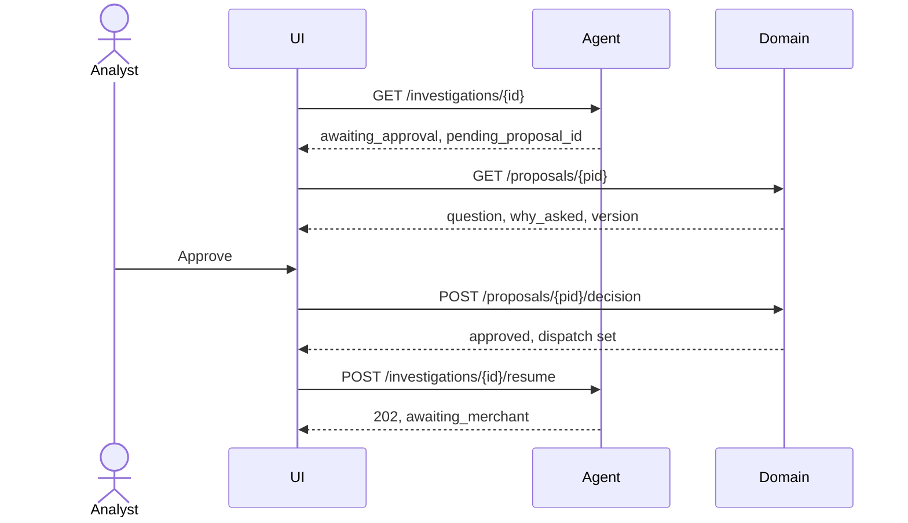
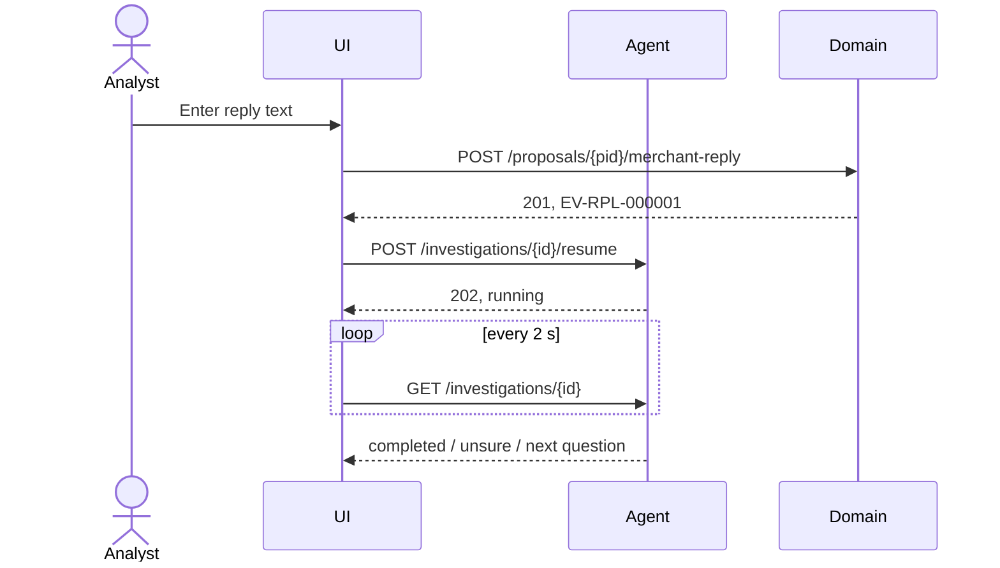

# UI workflow

v0.3 draft, Thu Nov 19, 2026. D-04, co-designed by Member 4 (frontend) and Member 2 (agent).

How an analyst works a case on `/cases/:caseId`, step by step.

- **Interactive version:** [Case page map](https://claude.ai/artifact/G9M6BHtwJTcLQy98PR1tFw). Click a step to see the page. Click a box to see what it does.
- **Read first:** sections 1 and 2. Sections 3–5 are reference for whoever builds it.
- **Builds on:** [architecture.md](architecture.md), [agent-graph.md](agent-graph.md), [contracts.md](contracts.md). No new endpoints, except `POST /auth/refresh` (agreed, not in contracts.md yet).

## Contents

1. [Workflow at a glance](#1-workflow-at-a-glance)
2. [The case page](#2-the-case-page)
3. [Statuses](#3-statuses)
4. [What each box shows](#4-what-each-box-shows)
5. [Actions and API calls](#5-actions-and-api-calls)

## 1. Workflow at a glance

✋ = the analyst acts. Everything else is the agent or Domain.

| Step | What the analyst sees | Analyst does |
|---|---|---|
| 1 Not started | Start button | Click Start |
| 2 Agent checking | Progress, checks and causes fill in | Watch |
| 3 Question to approve (M3) | The agent's question for the merchant | Edit, reject or approve |
| 4 Waiting for the reply (M3) | Reply form | Enter the reply, or "no reply". Agent goes back to step 2. |
| 5 Result and action | Cause, plus the recommended action | Approve or reject the action |
| 6 Action sent | Recheck card, scheduled | Wait, or run the recheck (demo) |
| 7 Not improved | Recheck result, Start comes back | Start a new investigation |
| 8 Second investigation | New run. The first run folds into a card above. | Same as step 2 on |
| Run failed | Error box, Start again | Start again |

M3 = only after merchant questions turn on. Before M3, the agent goes straight from step 2 to step 5.

Where a case ends:

- **Closed:** recheck improved.
- **Paused:** recheck had too few orders.
- **Analyst review:** the agent is unsure, the action is rejected, or the second fix also fails.

Key rules:

- **The frontend triggers resume.** Domain never calls the agent.
- **Decide first, then resume.** Each question decision and each reply is two calls.
- **No resume after the action decision.** The investigation has already ended.
- **Max 2 questions per run.** One open at a time.
- **Max 2 investigations per case.** The second starts only after a reopen.

## 2. The case page

16 boxes. Numbers match the [Case page map](https://claude.ai/artifact/G9M6BHtwJTcLQy98PR1tFw).

| # | Box | What it is | Data | Build |
|---|---|---|---|---|
| 1 | `CaseHeader` | Which case, and how bad | Domain `GET /cases/{id}` | D-02 |
| 2 | `DailyRateChart` | When the rate jumped | Domain `daily_rates` | D-02 |
| 3 | `InvestigationPanel` | Holds the agent's run. Boxes 4–12 live inside. | Agent `GET /investigations/{id}` | D-02 |
| 4 | `StartInvestigationButton` | Starts the agent. Analysts only. | Agent `POST /investigations` | D-02 |
| 5 | `InvestigationProgress` | Checks done, and what the agent checks now | Agent `step_count`, `max_steps` | D-02 |
| 6 | `QuestionReview` | Approve a question before it goes to the merchant | Domain proposal | To build, M3 |
| 7 | `MerchantReplyForm` | Enter the merchant's answer, or no reply | Domain merchant reply | To build, M3 |
| 8 | `ResultPanel` | The agent's conclusion | Agent `result` | To build |
| 9 | `RecommendationReview` | Approve the action. Reject sends the case to analyst review. | Domain proposal, dispatch | To build |
| 10 | `ErrorPanel` | Why the run stopped | Agent `error` | To build |
| 11 | `CheckTimeline` | Each check, and what it found | Agent `checks[]` | To build |
| 12 | `HypothesisList` | Possible causes, and where each stands | Agent `hypotheses[]` | To build |
| 13 | `RecheckPanel` | Did the fix work? Compared with untouched orders. | Domain rechecks | To build |
| 14 | `EvidenceDrawer` | The record behind an evidence ID | Domain `GET /evidence/{id}` | To build |
| 15 | `PreviousInvestigation` | The first run, folded: cause, action, failed recheck | Agent `GET /investigations/{reopen_of}`, Domain rechecks | To build |
| 16 | `AuditLog` | Who did what, and when | Domain `GET /cases/{id}/audit` | To build |

Layout:

- **Boxes 6–10 share one spot.** One at a time.
- **`AuditLog`** is a sidebar on wide screens. On narrow screens it drops to the bottom.

Which box shows at each step:

- **Always:** 1, 2, 3, 16.
- **On click of an evidence ID:** 14.

| Box | 1 | 2 | 3 | 4 | 5 | 6 | 7 | 8 | Failed |
|---|:-:|:-:|:-:|:-:|:-:|:-:|:-:|:-:|:-:|
| 4 `StartInvestigationButton` | ✓ | | | | | | ✓ | | ✓ |
| 5 `InvestigationProgress` | | ✓ | paused | paused | | | | ✓ | |
| 6 `QuestionReview` | | | ✓ | read-only | read-only | read-only | read-only | | |
| 7 `MerchantReplyForm` | | | | ✓ | | | | | |
| 8 `ResultPanel` | | | | | ✓ | ✓ | ✓ | | |
| 9 `RecommendationReview` | | | | | ✓ | ✓ | ✓ | | |
| 10 `ErrorPanel` | | | | | | | | | ✓ |
| 11 `CheckTimeline` | | ✓ | ✓ | ✓ | ✓ | ✓ | ✓ | ✓ | ✓ |
| 12 `HypothesisList` | | ✓ | ✓ | ✓ | ✓ | ✓ | ✓ | ✓ | ✓ |
| 13 `RecheckPanel` | | | | | | ✓ | ✓ | | |
| 15 `PreviousInvestigation` | | | | | | | | ✓ | |

Notes:

- **Start button label:** "Start investigation" (1), "Start new investigation" (7), "Start again" (failed).
- **Read-only question:** shows the decision and the reply as history. Once shown, it stays until the run ends. Only if this run asked one.
- **Unsure result:** `ResultPanel` shows "No cause confirmed" and the gaps. No `RecommendationReview`.
- **Viewers:** see everything, but no buttons. Decision boxes say "Only analysts can decide."

## 3. Statuses

Two status fields drive the page:

- **`investigation_status`:** one agent run. The agent owns it. Drives boxes 5–12.
- **`case_status`:** the whole case. Domain owns it. Drives the header badge and boxes 4, 13, 15.

| Step | `investigation_status` | `case_status` |
|---|---|---|
| 1 Not started | — | `open` |
| 2 Agent checking | `running` | `investigating` |
| 3 Question to approve | `awaiting_approval` | `awaiting_decision` |
| 4 Waiting for the reply | `awaiting_merchant` | `awaiting_merchant` |
| 5 Result and action | `completed` | `awaiting_decision` |
| 6 Action sent | `completed` | `action_dispatched` |
| 7 Not improved | `completed` | `reopened` |
| 8 Second investigation | `running` (new run) | `investigating` |
| Run failed | `failed` | `open`, with `last_error` |
| Unsure | `unsure` | `analyst_review` |
| Ends | — | `closed`, `paused` or `analyst_review` |

`investigation_status` values:

- **Active:** `running`.
- **Paused, waiting for a human:** `awaiting_approval`, `awaiting_merchant`.
- **Final:** `completed`, `unsure`, `failed`.
- **`unsure` is a valid result,** not an error.

Full event-to-status table: [contracts.md, Status model](contracts.md#status-model).

## 4. What each box shows

All shapes are in [contracts.md](contracts.md).

### Result and causes → `InvestigationResult`, `Hypothesis`

| Field | UI use |
|---|---|
| `outcome` | Diagnosis or unsure layout |
| `cause_category`, `summary` | Headline |
| `confidence` | Badge: low / medium / high |
| `cause_started_at` | "Since" date |
| `supporting_evidence_ids`, `contradicting_evidence_ids` | Evidence links |
| `ruled_out[]` | "Ruled out" list, with reason |
| `evidence_gaps[]` | "Couldn't check" list |
| `unverified_reply_claims[]` | "Merchant said, not verified" list |
| `hypotheses[].status` | Tag: open / supported / ruled out / inconclusive |

### Checks → `CheckSummary`

| Field | UI use |
|---|---|
| `kind` | Tag: explore / test / challenge |
| `tool` | Readable tool name |
| `purpose` | Main line |
| `headline` | Result line |
| `data_sufficient` | "Not enough data" tag when `false` |
| `matched` | Per cause: as predicted / against / neither |
| `evidence_ids` | Evidence links |

### Question and action → `Proposal`

| Field | UI use |
|---|---|
| `kind` | Question or action layout |
| `content.question_text`, `content.why_asked` | Question box |
| `content.title`, `instructions`, `owner_team`, `target` | Action box |
| `version` | Sent with the decision |
| `status`, `decided_by`, `decided_at`, `decision_note` | Decision history |
| `dispatch` | "Sent to …" line after approval |

Action box states:

- **Review:** Edit, Reject, Approve.
- **Approved:** "Approved by … · sent to … · DSP-…".
- **Rejected:** nothing is sent. Case goes to analyst review.
- **Send failed:** the action stays pending. Approve again.

### Display rules

- **`rate: null` shows "Not enough data".** Never "0%".
- **Rates show the sample size.** For example "12 / 240 (5.0%)".
- **Customer and merchant text is plain text.** No HTML.
- **Times show in the store's `timezone`.**

### Error messages → `InvestigationView.error`

- **Pick the message from `error.code`.** See [investigation error codes](contracts.md#investigation-error-codes).
- **`error.message` is for developers.** Show it only under "Details".
- **Every code allows Start again.**

| `error.code` | Analyst sees |
|---|---|
| `UPSTREAM_UNAVAILABLE` | A service didn't respond. Try again in a minute. |
| `UNAUTHENTICATED` | Your session expired during the run. Try again. |
| `DOMAIN_REJECTED` | The data service refused a request. Try again, and report it if it repeats. |
| `MODEL_REFUSED` | The AI model stopped before it could finish. Try again. |
| `MODEL_TRUNCATED` | The AI model's answer was cut off. Try again. |
| `RUN_TIMEOUT` | The investigation ran over its time limit and stopped. |
| `AGENT_RESTARTED` | The agent service restarted during the run. |
| `INTERNAL`, or unknown | Something went wrong. Try again, and report the investigation ID if it repeats. |

## 5. Actions and API calls

Paths as the browser calls them, with the gateway prefix.

| Step | Action | Calls, in order | Then |
|---|---|---|---|
| 1, failed | Start | 1. `POST /auth/refresh`, if the token is too old 2. `POST /agent/investigations` `{case_id, reopen_of: null}` | Poll |
| 7 | Start new investigation | Same, with `reopen_of: <last investigation_id>` | Poll |
| 3, 5 | Edit question or action | `POST /domain/proposals/{id}/versions` | Refresh proposal |
| 3 | Approve or reject question | 1. `POST /domain/proposals/{id}/decision` 2. `POST /agent/investigations/{id}/resume` | Poll |
| 4 | Record reply | 1. `POST /domain/proposals/{id}/merchant-reply` `{outcome: "replied", text}` 2. resume | Poll |
| 4 | Record no reply | 1. Same, `{outcome: "no_reply", text: null}` 2. resume | Poll |
| 5 | Approve or reject action | `POST /domain/proposals/{id}/decision` | Refresh case. **No resume.** |
| 6 | Run recheck (demo) | `POST /domain/rechecks/{id}/run` | Refresh case |

### When a call is refused

| Response | UI does |
|---|---|
| 401 `UNAUTHENTICATED` on Start | Refresh the token, send Start once more |
| 409 `INVESTIGATION_ACTIVE` | Not an error. Show the run in `error.details.investigation_id`. Poll if `running`. |
| 409 `REOPEN_NOT_ALLOWED` | Refresh the case. The button was out of date. |
| 409 `STALE_VERSION` | Someone edited it. Reload the proposal and show the new version. |
| 502 `DISPATCH_FAILED` | Show "Send failed". The proposal is still pending. |
| 403 `FORBIDDEN` | The role changed. Show the message. |
| 404 `CASE_NOT_FOUND` | "Case not found" page |

### Fresh token before Start

Why:

- **The agent uses the Start token for the whole run.** Up to 20 min (`AGENT_RUN_TIMEOUT_SECONDS`).
- **So it refuses a token that expires sooner.** 401 `UNAUTHENTICATED`.
- **Tokens last 60 min** (`JWT_TTL_MINUTES`). Without a refresh, Start fails in the last 20 min of a session.

What the UI does:

1. **Read `exp` from the JWT.** Decode only, no verify.
2. **Less than 25 min left?** Call `POST /auth/refresh` first. The extra 5 min cover clock drift.
3. **Send Start** with the new token.
4. **Still 401?** Refresh and retry once. Only once.
5. **Refresh failed?** Go to login, then back to this case.

The analyst only ever sees step 5.

### Request rules

- **`Idempotency-Key`** on decision, reply, resume and recheck run.
- **One key per click.** A network retry reuses it.
- **A decision sends `version`.** The version the analyst saw.
- **Resume has an empty body.** The agent re-reads Domain.

### Polling

- **While `running`:** `GET /agent/investigations/{id}` every 2 s.
- **Any other status:** stop.
- **While paused:** no polling. Refetch on page focus and after each action.
- **Which run to show:** `CaseDetail.investigation_ids[0]`, the newest.

### Steps 3 → 4, end to end

### Steps 4 → 2, end to end

