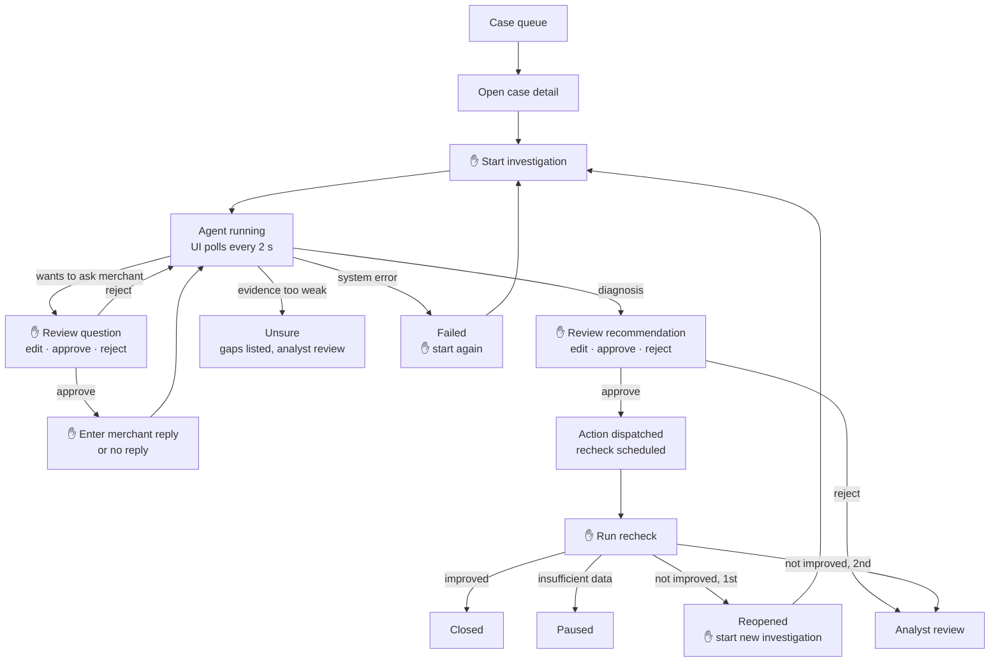
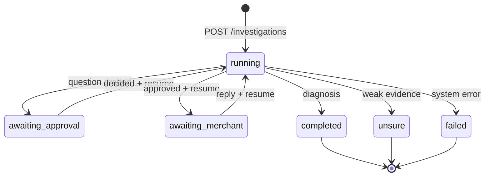
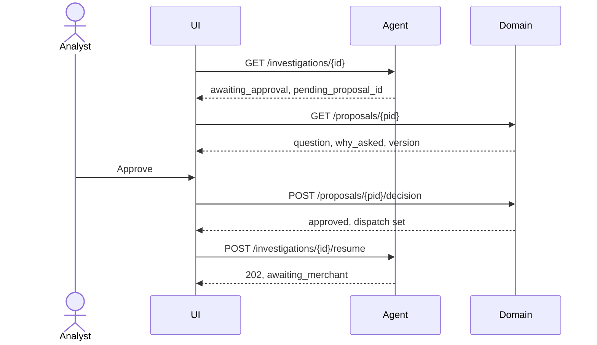
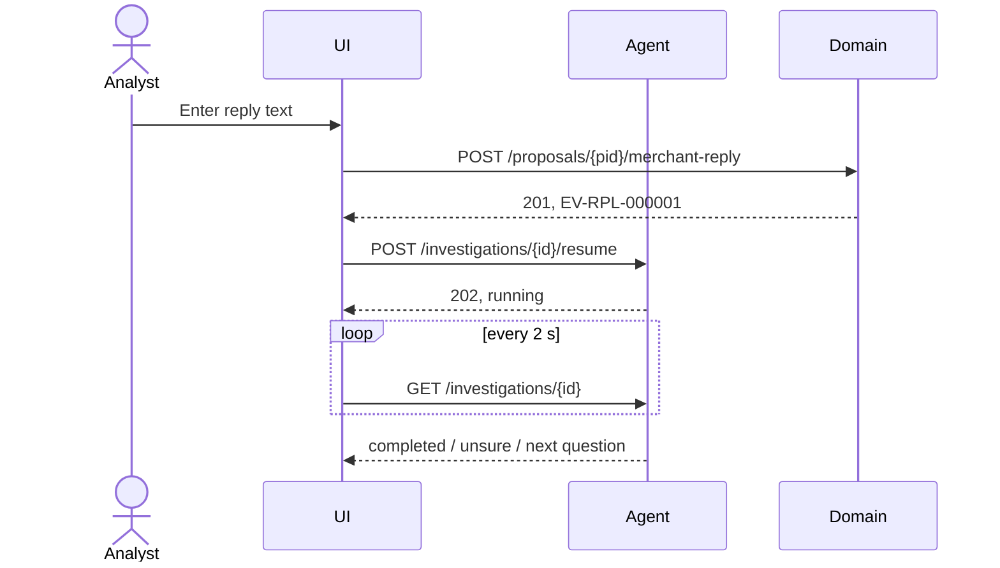

# UI workflow

v0.1 draft, Wed Nov 18, 2026. D-04, co-designed by Member 4 (frontend) and Member 2 (agent).

The investigation from the analyst's view:

- Which screen shows each agent state
- Where a human must act
- Which API calls each action makes, in order

It builds on [architecture.md](architecture.md), [agent-graph.md](agent-graph.md) and
[contracts.md](contracts.md). It adds no new endpoints.

## Contents

1. [Analyst workflow](#analyst-workflow)
2. [State-to-component map](#state-to-component-map)
3. [What the UI shows: findings, checks, prompts](#what-the-ui-shows)
4. [Human actions and API calls](#human-actions-and-api-calls)
5. [Mocks](#mocks)

## Analyst workflow

The analyst acts at each ✋ step. Everything else is the agent or the Domain Service.

Key points:

- **The frontend triggers resume.** Domain never calls the agent.
- **Decide first, then resume.** Every question decision and every reply is two calls.
- **A recommendation decision needs no resume.** The investigation has already ended.
- **Max 2 questions per run.** Only one is open at a time.
- **Max 2 investigations per case.** The second one starts only after a reopen.

The six `investigation_status` values, owned by the agent:

| Status | Kind | Meaning | Analyst can |
|---|---|---|---|
| `running` | Active | Agent checks data | Watch |
| `awaiting_approval` | Paused | Question drafted | Edit, approve, reject |
| `awaiting_merchant` | Paused | Question sent | Record reply or no reply |
| `completed` | Final | Diagnosis plus pending recommendation | Edit, approve, reject the recommendation |
| `unsure` | Final | No cause supported. A valid result, not an error. | Read gaps. Case goes to analyst review. |
| `failed` | Final | Operational error | Start a new investigation |

## State-to-component map

Proposed components on `/cases/:caseId`.

| Component | Shows | Data source |
|---|---|---|
| `CaseHeader` | Store, `case_status`, M&I rate vs baseline | Domain `CaseDetail` |
| `StartInvestigationButton` | Start, or start after reopen | Domain `CaseDetail` |
| `InvestigationProgress` | Spinner, `step_count / max_steps` | Agent `InvestigationView` |
| `HypothesisList` | Each cause and its status | Agent `hypotheses[]` |
| `CheckTimeline` | Each check: kind, purpose, headline | Agent `checks[]` |
| `QuestionReview` | Question, why asked, edit/approve/reject | Domain `Proposal` (`merchant_question`) |
| `MerchantReplyForm` | Reply text or "no reply" | Domain `Proposal`, then `MerchantReply` |
| `ResultPanel` | Cause, confidence, summary, ruled out, gaps | Agent `result` |
| `RecommendationReview` | Action, owner, target, edit/approve/reject | Domain `Proposal` (`intervention` / `handoff`) |
| `ErrorPanel` | Error message and start-again button | Agent `error` |
| `EvidenceDrawer` | One evidence record | Domain `GET /evidence/{id}` |
| `RecheckPanel` | Before/after rates, sample sizes (D-05) | Domain `Recheck[]` |

Which components are visible in each `investigation_status`:

| Component | `running` | `awaiting_approval` | `awaiting_merchant` | `completed` | `unsure` | `failed` |
|---|:-:|:-:|:-:|:-:|:-:|:-:|
| `InvestigationProgress` | ✓ | paused | paused | — | — | — |
| `HypothesisList` | ✓ | ✓ | ✓ | ✓ | ✓ | if any |
| `CheckTimeline` | ✓ | ✓ | ✓ | ✓ | ✓ | if any |
| `QuestionReview` | — | ✓ | read-only | read-only | read-only | — |
| `MerchantReplyForm` | — | — | ✓ | — | — | — |
| `ResultPanel` | — | — | — | ✓ | ✓ | — |
| `RecommendationReview` | — | — | — | ✓ | — | — |
| `ErrorPanel` | — | — | — | — | — | ✓ |

"Read-only" means past questions show as history, with their decision and reply.

## What the UI shows

The three structured shapes D-04 must agree on. All exist in [contracts.md](contracts.md).

**Findings** → `InvestigationResult`, `Hypothesis`

| Field | UI use |
|---|---|
| `outcome` | Diagnosis or unsure layout |
| `cause_category`, `summary` | Headline |
| `confidence` | Badge: low / medium / high |
| `cause_started_at` | "Started on" date |
| `supporting_evidence_ids`, `contradicting_evidence_ids` | Evidence links |
| `ruled_out[]` | "Ruled out" list, with reason |
| `evidence_gaps[]` | "What we couldn't check" list |
| `unverified_reply_claims[]` | "Merchant said, not verified" list |
| `hypotheses[].status` | Tag: open / supported / ruled out / inconclusive |

**Tool summaries** → `CheckSummary`

| Field | UI use |
|---|---|
| `kind` | Tag: explore / test / challenge |
| `tool` | Readable tool name |
| `purpose` | Main line of the timeline item |
| `headline` | Result line |
| `data_sufficient` | "Not enough data" warning when `false` |
| `matched` | Per hypothesis: as predicted / against / neither |
| `evidence_ids` | Evidence links |

**Approval prompts** → `Proposal`

| Field | UI use |
|---|---|
| `kind` | Question or recommendation layout |
| `content.question_text`, `content.why_asked` | Question review |
| `content.title`, `instructions`, `owner_team`, `target` | Recommendation review |
| `version` | Sent with the decision |
| `status`, `decided_by`, `decided_at`, `decision_note` | Decision history |
| `dispatch` | "Sent to …" line after approval |

Display rules:

- **`rate: null` shows "Not enough data".** Never "0%".
- **Rates show the sample size.** For example "12 / 240 (5.0%)".
- **Customer and merchant text is plain text.** No HTML rendering.
- **Timestamps** show in the store's `timezone`.

## Human actions and API calls

Paths are as called from the browser, with the gateway prefix.

| Action | Calls, in order | Then |
|---|---|---|
| Start | `POST /agent/investigations` `{case_id, reopen_of: null}` | Poll |
| Start after reopen | `POST /agent/investigations` `{case_id, reopen_of: <last investigation_id>}` | Poll |
| Edit question or recommendation | `POST /domain/proposals/{id}/versions` | Refresh proposal |
| Approve or reject question | 1. `POST /domain/proposals/{id}/decision` 2. `POST /agent/investigations/{id}/resume` | Poll |
| Record reply | 1. `POST /domain/proposals/{id}/merchant-reply` `{outcome: "replied", text}` 2. resume | Poll |
| Record no reply | 1. same, `{outcome: "no_reply", text: null}` 2. resume | Poll |
| Approve or reject recommendation | `POST /domain/proposals/{id}/decision` | Refresh case. **No resume.** |
| Run recheck (demo) | `POST /domain/rechecks/{id}/run` | Refresh case |
| Start again after failure | Same as Start | Poll |

Request rules:

- **`Idempotency-Key`** goes on decision, reply, resume and recheck run.
- **One key per click.** A network retry reuses the same key.
- **A decision sends `version`.** It must be the version the analyst saw.
- **Resume has an empty body.** The agent re-reads Domain.

Polling:

- **While `running`:** `GET /agent/investigations/{id}` every 2 s.
- **Stop** on any other status.
- **While paused:** no polling. Refetch on page focus and after each action.
- **Which investigation to show:** `CaseDetail.investigation_ids[0]`, the newest.

Question approval, end to end:

Merchant reply, end to end:

## Mocks

Contract-matched fixtures, so the UI is built before B-03 and C-03 land.

- **Switch:** the existing `VITE_USE_MOCKS=true`
- **Shapes:** exactly the DTOs in [contracts.md](contracts.md)

| File | What |
|---|---|
| `frontend/src/api/mocks/fixtures.js` | Static fixtures, one per screen |
| `frontend/src/api/mocks/mockInvestigations.js` | Stateful mock endpoints that move through the flow |

Static fixtures:

| Fixture | `status` | Case | Contents |
|---|---|---|---|
| `investigationRunning` | `running` | CASE-0002 | 4 checks, packing leading, `result: null` |
| `investigationAwaitingApproval` | `awaiting_approval` | CASE-0002 | 7 checks, `pending_proposal_id` set |
| `investigationAwaitingMerchant` | `awaiting_merchant` | CASE-0002 | Same, question approved and dispatched |
| `investigationCompleted` | `completed` | CASE-0001 | The contracts.md example: POS modifier, high confidence |
| `investigationPackingCompleted` | `completed` | CASE-0002 | Packing diagnosis after the merchant reply |
| `investigationUnsure` | `unsure` | CASE-0002 | Question rejected, packing vs Dasher handoff unresolved |
| `investigationFailed` | `failed` | CASE-0001 | `error.code: "UPSTREAM_UNAVAILABLE"` |
| `proposalRecommendation` | — | CASE-0001 | `handoff` to `pos_team`, `pending` |
| `proposalQuestion` | — | CASE-0002 | `merchant_question`, `pending`, version 1 |
| `proposalPackingRecommendation` | — | CASE-0002 | `intervention` for the merchant, `pending` |
| `merchantReply` | — | CASE-0002 | `EV-RPL-000001`, `replied` |

Mock flows:

| Case | Path |
|---|---|
| CASE-0001 | `running` → `completed` |
| CASE-0002, approve, reply | `running` → `awaiting_approval` → `awaiting_merchant` → `running` → `completed` |
| CASE-0002, approve, no reply | … → `awaiting_merchant` → `running` → `unsure` |
| CASE-0002, reject | `running` → `awaiting_approval` → `running` → `unsure` |
| Any case after `__mocks.failNextStart()` | `running` → `failed` |

Mock behavior:

- **Each poll while `running`** adds one check.
- **Resume** re-reads the mock proposal and reply, like the real agent. No change, no effect.
- **Access and errors** follow the contract: viewer gets 403, other stores 404, plus `STALE_VERSION`, `ALREADY_DECIDED`, `REPLY_EXISTS` and the rest.
- **Errors** use the contract envelope, so `getErrorMessage` works unchanged.
- **Dev console:** `__mocks.failNextStart()`, `__mocks.reset()`, `__mocks.db()`.
